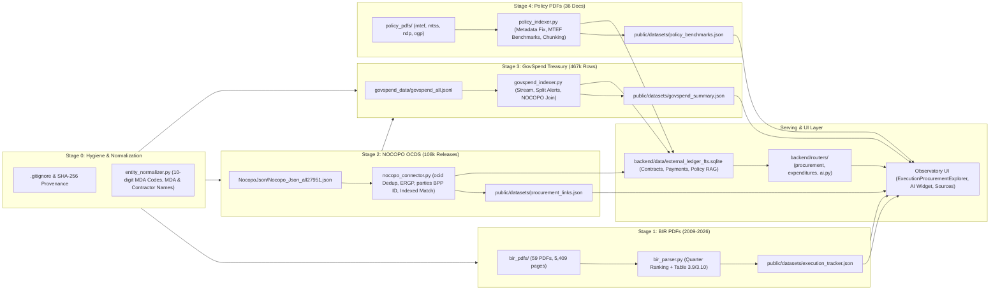

# BudgetLens External Data Ingestion & Cross-Linking Plan

> **Document Status:** `READY FOR APPROVAL — SEQUENTIAL EXECUTION GATE`  
> **Created:** 2026-11-21  
> **Companion Tracker:** [PENDING_EXTERNAL_DATA_INGESTION.md](file:///c:/Users/lol/Downloads/Projetcs/buget_lens/PENDING_EXTERNAL_DATA_INGESTION.md) | [PHASE2_IMPLEMENTATION_ROADMAP.md](file:///c:/Users/lol/Downloads/Projetcs/buget_lens/PHASE2_IMPLEMENTATION_ROADMAP.md)  
> **Scope:** Clean, normalize, parse, index, and cross-link all four external government datasets now on disk (`bir_pdfs`, `NocopoJson`, `govspend_data`, `policy_pdfs`) into BudgetLens (`public/datasets/`, `backend/data/external_ledger_fts.sqlite`, FastAPI routers, and the React Observatory UI).

---

## Mandatory Governance & Engineering Rules

1. **Sequential Stage Approval Gate:** Execute **Stages 0 through 4** sequentially (`Stage 0` -> `Stage 1` -> ... -> `Stage 4`). After completing and verifying each stage, present test and build outputs and wait for user approval before proceeding to the next stage (unless the user explicitly approves batching stages, e.g., Stage 0 + Stage 1).
2. **Zero Disruption to Live Stage-2 Enrichment:** Never modify, stop, or wipe `ingestion/checkpoints_data/`. Any dataset rewrites or provenance updates must preserve `preserve_existing_gemma=True` and keep existing Stage-2 Gemma reviews intact.
3. **Atomic Writes & Full Provenance:** Every JSON and SQLite output under `public/datasets/` and `backend/data/` must be written atomically via temp-file + `os.replace()` and record source SHA-256 checksums.
4. **Zero-Fabrication Policy:** Never emit synthetic execution percentages, contractor awards, CAC RC numbers, or beneficial owners where source records omit them. Missing/scanned/planning-only records must be flagged explicitly.
5. **Strict Download Format Policy (PDF & DOCX Only):** Any new UI exports must route through `triggerVerifiedDocumentDownload()` in [src/utils/documentExporter.ts](file:///c:/Users/lol/Downloads/Projetcs/buget_lens/src/utils/documentExporter.ts) (`sanitizePdfText()` for PDFs, OOXML `.docx` only — never `.csv`, `.json`, `.html`, or `.md` download buttons in `src/`).

---

## Verified Dataset Inventory on Disk (2026-11-21)

| Dataset | Location | Verified Volume & Coverage | Audit Findings Requiring Action Before / During Ingestion |
|---|---|---|---|
| **Budget Implementation Reports (BIR)** | `bir_pdfs/<year>/` | `59` valid `%PDF-` files (`5,409` pages) across `2009–2026`; `63` listed in [bir_pdfs/manifest.json](file:///c:/Users/lol/Downloads/Projetcs/buget_lens/bir_pdfs/manifest.json) (`4` server-side errors: `2023` Q1–Q3 non-PDF, `2022` Q3 `404`) | `56` PDFs have native text (`>= 300` chars/pg); `3` are image-only/scanned (`2016` Q2 `44` pgs, `2024` Consolidated `487` pgs, `2024` Unity Schools `188` pgs — while `2024-fourth-quarter-budget-implementation-report-2.pdf` has clean text & Tables `3.1–3.10`). Existing [bir_parser.py](file:///c:/Users/lol/Downloads/Projetcs/buget_lens/ingestion/parsers/bir_parser.py) only reads `bir_pdfs/<year>/*.csv` and ignores `*.pdf`. Multiple reports per year require quarter ranking (`Q4` > `Q3` > `Q2` > `Q1`) and specialty exclusions. |
| **NOCOPO Procurement (BPP OCDS 1.1)** | `NocopoJson/Nocopo_Json_all27951.json` | `219,973,019` bytes (`219.97 MB`); `108,346` releases | Contains `9,480` duplicate `ocid`s across stages (`planning`: `108,346`, `tender`: `18,422`, `awards`: `17,431`, `contracts`: `17,055`, `implementation`: `14,906`). Existing [nocopo_connector.py](file:///c:/Users/lol/Downloads/Projetcs/buget_lens/ingestion/parsers/nocopo_connector.py) defaults to missing `procurement_data/`, misses `342` `ERGP` codes in `planning.budget.description`, misses `14,901` supplier BPP IDs (`NG-BPP-BPP-CI-*`) stored in `parties[]`, ignores `implementation.transactions[]`, includes typo years (`2001`, `2027–2033`, `2922`), uses unindexed $O(N \times M)$ matching, and truncates at `links[:500]`. |
| **GovSpend Open Treasury Expenditures** | `govspend_data/govspend_all.jsonl` & `.csv` | `467,780` unique payment rows (`2018-09-01` to `2026-06-19`); `1,005` orgs; `54,138` beneficiaries | Clean fields (`0` empty orgs, beneficiaries, descriptions, or amounts; `0` duplicate `payment_no`; `17` zero-amount rows). Payer code lengths vary (`434,249` 10-digit, `33,523` 9-digit missing leading `0`, `8` 7-digit). `151.8 MB` `pages.jsonl` duplicates `govspend_all.jsonl`. No ingestion script, SQLite FTS5 ledger, or UI tab exists yet; raw `151 MB` JSONL is too large for browser fetch. |
| **Budget Office Policy Documents** | `policy_pdfs/{mtef,mtss,ndp,ogp}/` | `36` valid `%PDF-` files (`37` listed in [policy_pdfs/manifest.json](file:///c:/Users/lol/Downloads/Projetcs/buget_lens/policy_pdfs/manifest.json); `2023-fiscal-framework.pdf` non-PDF error) | All `37` entries have `"financialYear": 0` in `manifest.json`; Finance Acts (`2020`, `2021`, `2023`) are misfiled under `mtef/` and `ogp/`. `32` PDFs extract text (`31` OK + `1` low-text), `4` are scanned (`2020-finance-act.pdf`, `finance-act-2023-2.pdf`, `citizen-s-guide-to-2022-2023-mtef-fsp.pdf`, `citizens-guide-to-2023-2025-mtef-fsp.pdf`). No parser or RAG consumer exists yet. |

---

## Sequenced Pipeline Architecture

---

## Stage-by-Stage Execution Plan

### Stage 0 — Repo Hygiene, Provenance & Shared Entity Normalization
**Why first:** `bir_pdfs`, `NocopoJson`, and `govspend_data` reference the same federal MDAs and vendors using inconsistent codes and suffixes (`0517001001` vs `BPP-NOC-517001001` vs `- HQTRS`), and the repository currently has no `.gitignore` protecting ~700+ MB of raw data.

- **Exact Target Files:**
  - Create `.gitignore`: exclude `bir_pdfs/`, `policy_pdfs/`, `NocopoJson/`, `govspend_data/`, `source_pdfs/`, `backend/data/*.sqlite`, `node_modules/`, `dist/`, `.venv/`.
  - Create `ingestion/parsers/entity_normalizer.py`:
    - Canonical 10-digit administrative code normalizer (zero-pads 9-digit GovSpend `payer_code`s and extracts NOCOPO `buyer.id` administrative codes, e.g., `NG-BPP-BPP-NOC-517001001` -> `0517001001`).
    - Canonical MDA name normalizer (strips `- HQTRS`, `MAIN MOD`, punctuation, and `FEDERAL MINISTRY OF` variations).
    - Canonical contractor/beneficiary name normalizer (`LIMITED` -> `LTD`, `NIGERIA` -> `NIG`, strips punctuation/corporate noise) for NOCOPO <-> GovSpend joining.
  - Update [ingestion/indexers/build_provenance_manifest.py](file:///c:/Users/lol/Downloads/Projetcs/buget_lens/ingestion/indexers/build_provenance_manifest.py): add SHA-256 manifest entries for `bir_pdfs/`, `policy_pdfs/`, `NocopoJson/`, and `govspend_data/` without modifying Stage-2 checkpoint state.
  - *(Conditional on Decision #2 below)* Keep or remove `govspend_data/pages.jsonl` (`151.8 MB`) after verifying row equality with `govspend_all.jsonl` (`467,780` rows).
  - Create `tests/python/test_entity_normalizer.py`.
- **Verification:**
  - `.venv\Scripts\python.exe -m pytest tests/python/test_entity_normalizer.py` -> 100% pass.
  - Verify `git status` shows raw data archives and SQLite files ignored.

---

### Stage 1 — `bir_pdfs/` (`59` PDFs, `2009–2026`) -> Multi-Year Execution Tracker
**Why second:** Immediately upgrades `?tab=execution` from `2` verified years (`2016`, `2023`) to up to **`18` years (`2009–2026`)** inside the existing [ExecutionProcurementExplorer.tsx](file:///c:/Users/lol/Downloads/Projetcs/buget_lens/src/components/ExecutionProcurementExplorer.tsx) view.

- **Exact Target Files:**
  - Edit [ingestion/parsers/bir_parser.py](file:///c:/Users/lol/Downloads/Projetcs/buget_lens/ingestion/parsers/bir_parser.py):
    - Implement `select_authoritative_bir_pdfs()` per year: rank `Q4/Consolidated` > `Q3` > `Q2/Half-Year` > `Q1`, store `quarterCovered` (`Q1 | Q2 | Q3 | Q4`), and exclude specialty subset reports (`unity-schools`, `macroeconomics-financial-analysis`) from overwriting full FGN fiscal reports.
    - Implement `parse_bir_pdf(pdf_path, year)` using `pdfplumber` + `fitz` to extract:
      1. **Macro Fiscal Expenditure & Revenue tables** (`Table 3.9` / `FGN Budget Expenditure and Fiscal Account`: Aggregate Revenue, Recurrent Non-Debt, Personnel, Overhead, Debt Service, Capital Expenditure, Total Expenditure — converting Naira Billions to whole Naira).
      2. **MDA Capital Vote Utilization tables** (`Table 3.10` / `Appendix 1` where text-extractable: Appropriated, Released, Cash-Backed, Utilized, `% Utilized`).
    - Preserve `source_pdfs/2016/Total Capital and Capital Releases.pdf` (`697` MDAs) as authoritative MDA breakdown for `2016` while merging `2016` Q4 BIR macro rows; cleanly record `"scannedSkipped"` metadata for the `3` image-only PDFs (`2016` Q2, `2024` Consolidated, `2024` Unity Schools — or OCR if Decision #1 enables OCR).
  - Edit [src/components/ExecutionProcurementExplorer.tsx](file:///c:/Users/lol/Downloads/Projetcs/buget_lens/src/components/ExecutionProcurementExplorer.tsx):
    - Display quarter coverage badge (`Q4 Full-Year` vs `Q2 YTD` for `2026` / `2010`), render both Macro Fiscal table and MDA Capital Utilization table when present, and add a multi-year execution rate trend chart across `2009–2026`.
  - Extend [tests/python/test_execution_procurement.py](file:///c:/Users/lol/Downloads/Projetcs/buget_lens/tests/python/test_execution_procurement.py).
- **Output Artifacts:**
  - Rebuilt [public/datasets/execution_tracker.json](file:///c:/Users/lol/Downloads/Projetcs/buget_lens/public/datasets/execution_tracker.json) via atomic `os.replace()`.
- **Verification:**
  - `.venv\Scripts\python.exe -m ingestion.parsers.bir_parser`
  - `.venv\Scripts\python.exe -m pytest tests/python/test_execution_procurement.py` (reconciliation bounds, zero NaN/negative rates, `2016` & `2023` preserved, multi-year coverage).
  - `npx tsc -b && npm run build`.

---

### Stage 2 — `NocopoJson/` (`108,346` Releases) -> Live Procurement & Contractor Bridge
**Why third:** Turns Tab 2 of `?tab=execution` from `AWAITING_PROCUREMENT_DROP` into live OCDS contract links and repeat-winner contractor concentration, and produces the normalized contractor index consumed by Stage 3.

- **Exact Target Files:**
  - Edit [ingestion/parsers/nocopo_connector.py](file:///c:/Users/lol/Downloads/Projetcs/buget_lens/ingestion/parsers/nocopo_connector.py):
    - Support reading `NocopoJson/` in addition to `procurement_data/` (or via `--proc`).
    - **Deduplicate by `ocid` (`9,480` duplicates):** Merge/retain highest maturity stage (`implementation` > `contract` > `award` > `tender` > `planning`) to avoid double-counting contract values.
    - **Stage separation & payment extraction:** Report counts per stage (`planningOnlyCount`, `tenderCount`, `awardedCount`, `implementationCount`); extract `contracts[].implementation.transactions[]` into `totalPaidNaira` vs `contractAwardNaira`.
    - **Fix ERGP & Title extraction:** Extract `ERGP\d+` via regex from `planning.budget.description`, `planning.budget.project`, `tender.title`, and `awards[0].title` (recovering the `342` ERGP references missed by `tender.id` / `budget.id`).
    - **Fix Supplier ID lookup (Zero Mislabeling):** Join `awards[0].suppliers[0].id` against top-level `parties[]` (`14,901` supplier identifiers) into `bppContractorId` (`BPP-CI-*`); keep `cacRcNumber: null` unless a real CAC dataset is provided.
    - **Sanitize dates:** Filter out-of-range typo years (`2001`, `2027–2033`, `2922`) outside `1999–2026` and prefer `awards[0].date` / `contracts[0].dateSigned`.
    - **Indexed matching & full FTS5 storage:** Replace nested $O(N \times M)$ loop with normalized MDA + token-inverted index; emit summary + concentration + top matched links to [public/datasets/procurement_links.json](file:///c:/Users/lol/Downloads/Projetcs/buget_lens/public/datasets/procurement_links.json) and store all deduplicated contracts in `backend/data/external_ledger_fts.sqlite` (`nocopo_contracts` + FTS5) so contracts beyond row `500` remain searchable.
  - Create `backend/routers/procurement.py` and register in [backend/main.py](file:///c:/Users/lol/Downloads/Projetcs/buget_lens/backend/main.py).
  - Update [src/components/ExecutionProcurementExplorer.tsx](file:///c:/Users/lol/Downloads/Projetcs/buget_lens/src/components/ExecutionProcurementExplorer.tsx) & [src/utils/documentExporter.ts](file:///c:/Users/lol/Downloads/Projetcs/buget_lens/src/utils/documentExporter.ts): show `BPP Contractor ID`, `Awarded vs. Disbursed`, stage breakdown, and searchable contracts (keeping strict PDF/DOCX exports).
  - Extend [tests/python/test_execution_procurement.py](file:///c:/Users/lol/Downloads/Projetcs/buget_lens/tests/python/test_execution_procurement.py).
- **Verification:**
  - `.venv\Scripts\python.exe -m ingestion.parsers.nocopo_connector --proc NocopoJson`
  - `.venv\Scripts\python.exe -m pytest tests/python/test_execution_procurement.py` (OCID dedup, ERGP extraction from description, `parties[]` BPP ID resolution, typo-year guard).
  - `npx tsc -b && npx vitest run && npm run build`.

---

### Stage 3 — `govspend_data/` (`467,780` Payments, `2018–2026`) -> Open Treasury Ledger & Follow-the-Money Cross-Link
**Why fourth:** With BIR execution benchmarks (Stage 1) and NOCOPO contracts (Stage 2) indexed, GovSpend completes the **Appropriation -> BIR Release -> NOCOPO Contract -> Treasury Cash Payment** trail.

- **Exact Target Files:**
  - Create `ingestion/parsers/govspend_indexer.py`:
    - Stream `govspend_data/govspend_all.jsonl` row-by-row with bounded memory, exclude/flag the `17` zero-amount rows, normalize `payer_code` to 10 digits via `entity_normalizer.py`, and normalize `organization_name` / `beneficiary_name`.
    - Populate `backend/data/external_ledger_fts.sqlite` (`govspend_payments` + `govspend_fts`) indexing all `467,780` rows by beneficiary, MDA, payer code, description, date, and amount.
    - Emit compact `< 2 MB` frontend summary `public/datasets/govspend_summary.json`:
      - Annual (`2018–2026`) & monthly cash disbursement totals
      - Per-MDA actual spend joined by 10-digit code & normalized MDA name
      - Top beneficiaries per year and **split-payment alerts** (same MDA + same beneficiary + multiple vouchers on the same day or rolling 7-day window)
      - **NOCOPO <-> GovSpend cross-link summary:** normalized contractor/beneficiary join comparing `NOCOPO Awarded Value` vs `GovSpend Cash Received`.
  - Create `backend/routers/expenditures.py` (`GET /api/expenditures/search`, `GET /api/expenditures/beneficiary`) and register in [backend/main.py](file:///c:/Users/lol/Downloads/Projetcs/buget_lens/backend/main.py).
  - Edit [src/components/ExecutionProcurementExplorer.tsx](file:///c:/Users/lol/Downloads/Projetcs/buget_lens/src/components/ExecutionProcurementExplorer.tsx) & [src/utils/documentExporter.ts](file:///c:/Users/lol/Downloads/Projetcs/buget_lens/src/utils/documentExporter.ts): add sub-tab **Open Treasury Payments (GovSpend)** (offline summary JSON + live full-ledger search when FastAPI is running, plus PDF/DOCX export).
  - Create `tests/python/test_govspend_indexer.py`.
- **Verification:**
  - `.venv\Scripts\python.exe -m ingestion.parsers.govspend_indexer`
  - `.venv\Scripts\python.exe -m pytest tests/python/test_govspend_indexer.py` (row count reconciliation = `467,780`, `payer_code` padding, FTS5 search & injection immunity, split-payment detection, NOCOPO join accuracy).
  - `npx tsc -b && npx vitest run && npm run build`.

---

### Stage 4 — `policy_pdfs/` (`36` PDFs) -> MTEF Macro Benchmarks & Grounded AI Policy RAG
**Why last:** Policy documents add statutory fiscal ceilings and policy citations on top of the transactional layers, enabling direct comparison of **MTEF Target -> Enacted Act -> BIR Actual** inside narratives and the Grounded AI Assistant.

- **Exact Target Files:**
  - Create `ingestion/parsers/policy_indexer.py`:
    - Enrich [policy_pdfs/manifest.json](file:///c:/Users/lol/Downloads/Projetcs/buget_lens/policy_pdfs/manifest.json) metadata: infer `fiscalYearStart` / `fiscalYearEnd` (replacing `"financialYear": 0`) and normalized `docType` (`MTEF_FSP`, `FINANCE_ACT`, `MTSS`, `NDP`, `OGP`, `CONSULTATION_GUIDE`) — resolving the Budget Office site's misfiled Finance Acts inside `mtef/` and `ogp/`.
    - Extract structured MTEF/FSP macro benchmark tables (oil price USD/bbl, oil production mbpd, FX rate, GDP growth, inflation, revenue/expenditure/deficit ceilings) into `public/datasets/policy_benchmarks.json`, and enrich [ingestion/parsers/narrative_parser.py](file:///c:/Users/lol/Downloads/Projetcs/buget_lens/ingestion/parsers/narrative_parser.py) / `public/datasets/narratives/`.
    - Chunk the `32` text-extractable policy PDFs (page-numbered passages + SHA-256) into `backend/data/external_ledger_fts.sqlite` (`policy_chunks` + `policy_fts`). Flag the `4` scanned PDFs explicitly as `OCR_PENDING` (unless Decision #1 enables OCR).
  - Edit [backend/routers/ai.py](file:///c:/Users/lol/Downloads/Projetcs/buget_lens/backend/routers/ai.py): add retrieval + strict citation verification across `external_ledger_fts.sqlite` (`nocopo_contracts`, `govspend_payments`, `policy_chunks`) and `execution_tracker.json` / `policy_benchmarks.json`.
  - Update **Sources & Methodology** UI to surface verified policy document inventory & SHA-256 hashes.
  - Create `tests/python/test_policy_indexer.py` & extend `tests/python/test_search_ai.py`.
- **Verification:**
  - `.venv\Scripts\python.exe -m ingestion.parsers.policy_indexer`
  - `.venv\Scripts\python.exe -m pytest tests/python/test_policy_indexer.py tests/python/test_search_ai.py` (zero fabricated citations, page-grounded policy quotes, manifest fiscal-year repair).
  - `npx tsc -b && npx vitest run && npm run build`.

---

## Master Stage Tracker

| Stage | Target Dataset / Layer | Primary Outputs | Status | Approval Gate |
|---|---|---|---|---|
| **Stage 0** | Hygiene, Provenance & Entity Normalizer | `.gitignore`, `entity_normalizer.py`, `source_provenance.json` (`externalSources` SHA-256) | `COMPLETED` | Verified (`5/5` Pytest pass, raw archives ignored) |
| **Stage 1** | `bir_pdfs/` (`59` PDFs, `2009–2026`) | `bir_parser.py` -> `execution_tracker.json` (`18` verified years `2009–2026`, `3` scanned PDFs / `1,247` `bir_ocr_fts` chunks + image-table recovery, `0` skipped) + UI/Exporter | `COMPLETED` | Verified (`Pytest`, `tsc`/`Vitest`/`vite build` pass; `scannedSkipped: []`) |
| **Stage 2** | `NocopoJson/` (`108,346` releases) | `nocopo_connector.py` -> `procurement_links.json` (`98,866` dedup OCIDs, `10,796` matched, `₦4,084.31B` awarded / `₦1,225.01B` disbursed) + `external_ledger_fts.sqlite` + `/api/procurement/search` + UI | `COMPLETED` | Verified (`18/18` Pytest, `50/50` Vitest, `tsc`/`vite build` exit `0`) |
| **Stage 3** | `govspend_data/` (`467,780` rows, `2018–2026`) | `govspend_indexer.py` -> `govspend_summary.json` (`467,763` valid, `17` zero-excluded, `₦47.53T` disbursed, `3,798` NOCOPO cross-links) + `external_ledger_fts.sqlite` + `/api/expenditures/search` + UI | `COMPLETED` | Verified (`20/20` Pytest, `50/50` Vitest, `tsc`/`vite build` exit `0`) |
| **Stage 4** | `policy_pdfs/` (`37` manifest entries: `32` native + `4` OCR-indexed, `1` invalid) + Unified AI RAG | `policy_indexer.py` -> `policy_benchmarks.json` (`3,214` FTS5 chunks, `14` MTEF macro benchmarks, `0` `OCR_PENDING`) + `policy_fts` + `ai.py` + `SourcesMethodologyPage.tsx` | `COMPLETED` | Verified (`Pytest`, `Vitest`, `tsc`/`vite build` exit `0`) |

---

## Decisions Applied

1. **OCR for Scanned PDFs (`bir_pdfs/`, `policy_pdfs/`, `dmo_pdfs/`):**
   - **Selected & Executed Option B (Zero-Skip Local OCR via `ingestion/parsers/ocr_engine.py`):** Implemented Windows native WinRT OCR (`windows-winrt-ocr` primary, `rapidocr-onnxruntime` fallback) with coordinate-preserving word boxes and atomic `ingestion/ocr_cache/` checkpoints. Recovered **all remaining valid scanned PDFs with `0` skipped (`OCR_PENDING = 0`)**: `4` Policy PDFs (`52` pages -> `3,214` total policy FTS5 chunks), `3` full-scanned BIR PDFs (`719` pages -> `1,247` `bir_ocr_fts` chunks) plus embedded BIR image tables (unlocking FY `2014` across `18` consecutive years `2009–2026`), and `8` single-page DMO PDFs (`public/datasets/debt_profile.json`).
2. **Cleanup of Redundant `govspend_data/pages.jsonl` (`151.8 MB`):**
   - **Selected Option A:** Keep untouched on disk as raw scraper backup, ignored via `.gitignore`.

---

## Next Action
All 5 stages (**Stage 0** through **Stage 4**) plus **Zero-Skip Local OCR Recovery** are `COMPLETED` and verified. Proceed to Phase 3 ([PHASE3_CROSS_DATASET_INTELLIGENCE_ROADMAP.md](file:///c:/Users/lol/Downloads/Projetcs/buget_lens/PHASE3_CROSS_DATASET_INTELLIGENCE_ROADMAP.md)).
