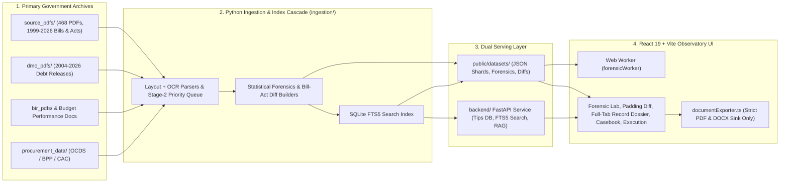

# BudgetLens Phase 2 — Investigative Forensics, Data Completeness & Full-Stack Verification Roadmap

> **Document Status:** `PHASE 2 COMPLETED — ALL 10 CHECKPOINTS (P2-1 TO P2-10) VERIFIED`  
> **Created:** 2026-11-19  
> **Predecessor:** Phase 1 Institutional Citability, Navigation Modernization & PDF/DOCX Overhaul (`IMPLEMENTATION_ROADMAP.md` — Checkpoints 1–7 Completed)  
> **Source Audit:** Derived directly from [zincom.md](file:///c:/Users/lol/Downloads/Projetcs/buget_lens/zincom.md) and live repository/dataset inspection.  
> **Scope:** Close every remaining data-coverage, client-stub, dormant-engine, and QA gap identified in `zincom.md` and elevate BudgetLens with a **Bill-vs-Act Budget Padding Diff Engine**, **Full-Tab Editorial Record Dossier & Virtual Schedule Card**, **All-28-Year FTS5 Search & Grounded AI RAG**, **Statistical Forensics Lab**, **Investigator Casebook & Formal FOI Packets**, **Execution/Procurement Tracking**, and **Persistent Citizen Field Verification + Automated QA/CI**.

---

## Mandatory Governance & Execution Protocol

> [!IMPORTANT]
> Every checkpoint below MUST obey these four non-negotiable engineering rules without exception:

1. **Exclusive Sequential Approval Gate (Hard Stop Between Checkpoints):**
   - Checkpoints **P2-1 through P2-10** MUST be executed strictly **one at a time** in sequential order (`P2-1` -> `P2-2` -> ... -> `P2-10`).
   - Upon completing a checkpoint, full verification outputs (TypeScript check `tsc -b`, Vite production build `npm run build`, automated unit/E2E test results, Python data reconciliation outputs, and zero-disallowed-download checks) MUST be presented clearly to the user.
   - **Execution MUST STOP at every checkpoint boundary and wait for explicit, exclusive user approval (e.g., *"Approve Checkpoint P2-1"* / *"Proceed to P2-2"*) before modifying or creating any files for the subsequent checkpoint.**
   - **Zero multi-checkpoint batching** is permitted unless the user explicitly overrides this rule in writing.

2. **100% Full-Implementation Mandate:**
   - Every deliverable inside every checkpoint MUST be **fully implemented end-to-end**: real dataset/API wiring, responsive light editorial + dark-obsidian styling matching `src/index.css`, strict TypeScript compilation (`noUnusedLocals`, zero `any` shortcuts where interfaces belong), zero `TODO` / mock / placeholder UI, zero runtime console errors, and passing automated verification.

3. **Strict Download Format Policy — PDF & DOCX Only:**
   - **The ONLY permitted downloadable file formats anywhere in BudgetLens are `.pdf` (`application/pdf`, `%PDF-` header) and `.docx` (`application/vnd.openxmlformats-officedocument.wordprocessingml.document`, `PK` OOXML zip header).**
   - Every new or upgraded Phase 2 export action MUST route exclusively through `triggerVerifiedDocumentDownload()` in `src/utils/documentExporter.ts`.
   - Adding `.csv`, `.json`, `.html`, `.md`, `.svg`, or binary data dump download triggers anywhere in `src/` is **strictly forbidden**. *(Clipboard copy helpers for citations, permalinks, or FOI text remain non-file clipboard actions.)*
   - All strings rendered via `jsPDF` MUST pass through `sanitizePdfText()` (`₦` -> `NGN `) so Helvetica WinAnsi encoding never produces mojibake, while `.docx` preserves native UTF-8 `₦`.

4. **Gradual Live-Streaming Stage-2 Enrichment & Daemon Coexistence (`task-540`):**
   - Background Stage-2 enrichment (`python -m ingestion.cli --stage2 --overnight`) is **intentionally designed as a gradual, hardware-safe background stream** (`task-540` actively publishing checkpoints every 10 records to `projects.min.json`, `db/<year>/records.json`, `statistics.json`, and `registry.json`).
   - **`task-540` MUST NOT be stopped or wiped.** Every record that finishes enriching MUST automatically propagate and display live across the UI via the 15-second `BudgetDatabaseContext` registry poll.
   - Any Phase 2 ingestion enhancement (checkpoints `P2-2`, `P2-3`, `P2-4`, `P2-7`, `P2-9`) MUST preserve atomic temp-file + `os.replace()` swaps on JSON/SQLite outputs, keep `preserve_existing_gemma=True`, and preserve completed checkpoint resume state in `ingestion/checkpoints_data/` so ongoing Stage-2 progress is never corrupted or lost.

---

## Verified Baseline Snapshot (Pre-Phase 2)

| Metric / System Layer | Verified Current Value (2026-11-19) | Source Reference |
|---|---|---|
| **Indexed Budget Years** | `28` years (`1999–2026`), `558,815` total items (`₦238.84T`) | `public/datasets/registry.json` |
| **Source PDF Provenance** | `468` primary PDFs hashed (`public/datasets/source_provenance.json`), but `registry.json` has empty `"sha256": ""` on `27/28` years | `public/datasets/registry.json`, `source_provenance.json` |
| **Stage-2 AI Enrichment *(Intentional Gradual Stream)*** | `1,065 / 558,815` live & actively growing every 10 records via `task-540` (`1999`: `60`, `2006`: `116`, `2009`: `889/10,008` at record `155/240` as of `20:25:30Z`); `4` live-display UI/schema wiring gaps found | `public/datasets/registry.json`, `task-540`, `ProjectEvidenceModal.tsx` |
| **Known Coverage Shortfalls** | Summary Acts only (`2000–2003`, `2005`, `2007`: `124–188` items); Sparse schedule extraction (`2006`: `502`, `2011`: `1,277` / `₦109.77B`, `2015`: `₦1.02T`) | `public/datasets/registry.json`, `source_pdfs/` |
| **Bill-vs-Act PDF Pairs on Disk** | `8` federal budget cycles (`2017`, `2019`, `2020`, `2021`, `2022`, `2023`, `2024`, `2025`) | `source_pdfs/<year>/` |
| **Execution / Performance PDFs on Disk** | `2016` (`Total Capital and Capital Releases.pdf`), `2023` (`2023 Budget Performance.pdf`), plus Implementation Guidelines (`2021`, `2025`) | `source_pdfs/<year>/` |
| **Dormant Engine Methods** | `getBenfordAnalysis`, `getPrematureReplacementAlerts`, `getVirementAnalytics`, `getDuplicateRingClusters` | `src/services/budgetDatabaseEngine.ts`, `BudgetDatabaseContext.tsx` |
| **Frontend Entry Chunk & Debt** | Main bundle `~594 kB`; empty `vendor-react` chunk (`0.00 kB`); main-thread rule/dupe compute (`App.tsx:89-104`); `7` orphan components + `canvas-confetti` | `vite.config.ts`, `App.tsx`, `package.json` |
| **Automated Test Coverage** | `0` unit tests, `0` E2E browser tests, no CI workflow | Repository root / `package.json` |

---

## Full Traceability Matrix (`zincom.md` -> Phase 2 Checkpoints)

Every single observation from [zincom.md](file:///c:/Users/lol/Downloads/Projetcs/buget_lens/zincom.md) is accounted for cleanly below:

| `zincom.md` Item | Gap / Proposition Summary | Assigned Checkpoint |
|---|---|---|
| **Part 1 §1.1** | Intentional gradual background enrichment (`task-540`: `1,065 / 558,815` streaming live) -> fix live UI display gaps (`matchedDbRecord`, `{}` guard, AI badges/progress) so every completed record surfaces across all views + non-disruptive priority ordering for upcoming queued files | **P2-2** *(Live Gradual Stage-2 Display Fixes & Non-Disruptive Priority Queue)* |
| **Part 1 §1.2** | Summary Acts (`2000–2003, 2005, 2007`) & extraction shortfalls (`2006, 2011, 2015`) | **P2-2** *(Coverage Audit, OCR/Table Recovery & Coverage Tiers)* |
| **Part 1 §1.3** | `registry.json` has `sha256: ""` on `27/28` years vs `source_provenance.json` | **P2-2** *(Cascade Step B Registry SHA-256 Sync)* |
| **Part 1 §2.1 & Part 2 #9a** | Citizen Field Tip Channel local-only state (`ProjectEvidenceModal.tsx:782-834`) | **P2-10** *(FastAPI Field Verification Persistence + Photo/GPS Upload)* |
| **Part 1 §2.2 & Part 2 #3** | "View PDF Record" shows a tiny dark card inside a small modal (`ProjectEvidenceModal.tsx:889-954`); raw scanned PDFs (`1999–2016`) are often noisy/skewed, so replace raw scans with a clean **Official Record Dossier Card** + **Open Full Record in New Tab (`?tab=record`)** | **P2-5** *(Editorial Record Dossier Card & Full-Tab Page)* |
| **Part 1 §2.3 & Part 2 #6** | SQL Data Explorer is a misleading single-year regex filter (`SqlDataExplorer.tsx:34-77`); retired completely per user decision (remove from sidebar, breadcrumbs, router, citations & UI presentations rather than adding heavy browser database dependencies) | **P2-6** *(Retire & Remove "SQL Explorer" Across UI & Presentations)* |
| **Part 1 §2.4 & Part 2 #7** | `⌘K` Universal Search "All Years" only searches RAM-loaded years (`UniversalSearchModal.tsx:101-120`) | **P2-7** *(SQLite FTS5 Backend Search + Static Index Fallback)* |
| **Part 1 §2.5** | AI Assistant (`GroundedAiAssistantWidget.tsx`) is single-year deterministic heuristic | **P2-7** *(Hybrid All-Year RAG + Strict Citation Verifier)* |
| **Part 1 §2.6 & Part 2 #9b** | FOI & MP letters clipboard-only (`ProjectEvidenceModal.tsx:728-888`), no MDA FOI directory | **P2-8** *(Formal FOI/Oversight PDF & DOCX Packets + MDA FOI Directory)* |
| **Part 1 §3 & Part 2 #4** | 4 dormant analytics methods unused in UI (`BudgetDatabaseContext.tsx:24-29`) | **P2-3** *(Statistical Forensics Lab + Precomputed Cross-Year Index)* |
| **Part 1 §4.1 & Part 2 #11c** | Zero automated test suite (`Vitest` / `Playwright` / CI) | **P2-1** *(Vitest Foundation)* & **P2-10** *(Playwright E2E + GitHub Actions CI)* |
| **Part 1 §4.2 & Part 2 #11a** | Main-thread `applyRules`/`detectDuplicates` blocking + `~594 kB` bundle + empty `vendor-react` | **P2-1** *(Forensic Web Worker + Lazy Splitting + Vite `manualChunks` Fix)* |
| **Part 1 §4.3 & Part 2 #11b** | Unused `canvas-confetti` + `7` orphaned components in `src/components/` | **P2-1** *(Codebase & Dependency Pruning)* |
| **Part 2 #1** | Executive Bill vs. Enacted Act "Budget Padding" Diff Engine | **P2-4** *(3-Tier Legislative Diff Pipeline + Explorer UI)* |
| **Part 2 #2** | Enacted vs. Actual Execution Tracker (BIR + Open Treasury) | **P2-9** *(Execution Parser & Released/Utilized Tracker)* |
| **Part 2 #5** | Procurement & Beneficial Ownership Bridge (NOCOPO / BPP / CAC) | **P2-9** *(OCDS / CAC Connector & Follow-the-Money Explorer)* |
| **Part 2 #8** | Investigator Casebook / Multi-Year Evidence Basket (PDF & DOCX Dossier) | **P2-8** *(Persistent Casebook Context, Drawer & Dossier Exporter)* |
| **Part 2 #10** | OCR Recovery & Forensic-Priority Enrichment | **P2-2** *(Targeted OCR Recovery & Priority Queue)* |
| **Bonus Synergy** | 109 Senatorial & 360 Federal Constituency directory for Zonal Intervention Projects | **P2-10** *(Constituency Mapping integrated with ZIP & Padding views)* |

---

## Master Checkpoint Tracker

| Checkpoint | Pillar / Feature Title | Primary Domains | Dependencies | Status | Approval Gate |
|---|---|---|---|---|---|
| **P2-1** | Engineering Hygiene, Forensic Web Worker, Bundle Splitting & Vitest Foundation | Frontend / Perf / QA | Phase 1 Complete | `COMPLETED` | Verified (`23/23` Vitest pass, `index` `594.13->103.29 kB`, `0` empty chunks, `npm run build` exit `0`) |
| **P2-2** | Live Gradual Stage-2 Display Fixes, Registry SHA-256 Sync & Historical Data Recovery (`2006, 2011, 2015`) | Frontend + Python Ingestion | `P2-1` | `COMPLETED` | Verified (`26/26` Vitest pass, `6/6` Pytest pass, `28/28` SHA-256 + `coverage_tier`, FY `2011`: `1,911` items / `₦1.07T`, FY `2015`: `12,420` items / `₦1.32T`, `1,105` live Gemma preserved on `task-540`, `npm run build` exit `0`) |
| **P2-3** | Statistical Forensics Lab *(Benford MAD, Premature Replacement, Virement & Duplicate Rings)* | Ingestion + Frontend | `P2-1`, `P2-2` | `COMPLETED` | Verified (`31/31` Vitest pass, `9/9` Pytest pass, `2.60 MB` precomputed JSON across `559,325` rows / `28` yrs, `150` lifecycle alerts, `3,225` cross-MDA rings, `npm run build` exit `0`) |
| **P2-4** | Executive Bill vs. Enacted Act "Budget Padding" Diff Engine (`2017–2025`) | Ingestion + Frontend | `P2-1` | `COMPLETED` | Verified (`35/35` Vitest pass, `11/11` Pytest pass, `7` cycles in `bill_act_diffs/` incl. `4` `LINE_ITEM_SCHEDULE` pairs `2019/2021/2022/2025`, `npm run build` exit `0`) |
| **P2-5** | Editorial Record Dossier Card & Full-Tab Official Record Page (`?tab=record`) | Frontend UI + Permalinks | `P2-1`, `P2-2` | `COMPLETED` | Verified (`38/38` Vitest pass, `OfficialRecordCard` `16.20 kB` + `BudgetRecordDossierPage` `9.31 kB` lazy chunks, `0` empty chunks, `npm run build` exit `0`) |
| **P2-6** | Retire & Remove "SQL Explorer" From Sidebar, UI, Routing & Presentations | Frontend Cleanup | `P2-1` | `COMPLETED` | Verified (`0` SQL Explorer hits in `src/` & `index.html`, `SqlDataExplorer.tsx` deleted, `0` dist chunks, `39/39` Vitest pass, `npm run build` exit `0`) |
| **P2-7** | Instant All-28-Year FTS5 Search (`⌘K`) & Strict-Grounding Hybrid RAG AI | Ingestion + Backend + Frontend | `P2-2` | `COMPLETED` | Verified (`559,325` rows in `225.16 MB` FTS5 DB + `1.38 MB` static fallback, `8.07–25.28 ms` query latency, `15/15` Pytest pass, `39/39` Vitest pass, `npm run build` exit `0`) |
| **P2-8** | Investigator Casebook (Multi-Year Evidence Basket) & Formal FOI / Oversight PDF+DOCX Packets | Frontend Context + Exporter | `P2-3`, `P2-4` | `COMPLETED` | Verified (`41/41` Vitest pass, `%PDF-` & `PK` binary checks for Casebook & FOI packets, `0` disallowed downloads, `npm run build` exit `0`) |
| **P2-9** | Enacted vs. Actual Execution Tracker (BIR/Open Treasury) & Procurement Bridge (NOCOPO/CAC) | Ingestion + Frontend | `P2-2` | `COMPLETED` | Verified (`18/18` Pytest pass, FY `2016`: `697` MDAs / `₦1,185.62B` vs `₦507.16B` (`42.78%`), FY `2023`: `107.6%`, `41/41` Vitest pass, `npm run build` exit `0`) |
| **P2-10** | Persistent Citizen Field-Verification Backend, Constituency Directory & Playwright CI Suite | Backend + Frontend + QA | `P2-5`, `P2-7`, `P2-8` | `COMPLETED` | Verified (`19/19` Pytest pass incl. EXIF/GPS scrub + magic bytes, `44/44` Vitest pass, `109` Sen. / `360` Fed. constituencies, `3/3` Playwright E2E Chromium pass, `STATIC_AUDITS_OK`, `npm run build` exit `0`) |

---

## Target System Architecture



---

## Detailed Checkpoints & Engineering Specifications

---

### Checkpoint P2-1 — Engineering Hygiene, Forensic Web Worker, Bundle Splitting & Vitest Foundation

#### 1. Objective & `zincom.md` Coverage
Resolve all engineering performance and dead-code debt (`zincom.md` Part 1 §4.1–§4.3; Part 2 #11): eliminate main-thread UI freezes when switching fiscal years (`~58,300` rows), cut the `~594 kB` initial JS chunk, remove dead components and `canvas-confetti`, fix Vite's empty `vendor-react` chunk, and stand up a fast **Vitest** regression test harness before building Phase 2 features.

#### 2. Verified Current State / Root Cause
- [App.tsx](file:///c:/Users/lol/Downloads/Projetcs/buget_lens/src/App.tsx#L1-L19) eagerly imports heavyweight components (`GroundedAiAssistantWidget` [1,787 lines], `GeoMapWidget` [569 lines], `BudgetAuditCalculatorWidget`, `SpendingTrendChart`, `UniversalSearchModal` [412 lines], `ProjectEvidenceModal` [1,006 lines]), producing `dist/assets/index-*.js` at `594.13 kB`.
- `App.tsx` lines `89–104` execute `applyRules(extractedProjects)` and `detectDuplicates(extractedProjects)` synchronously inside a `setTimeout(..., 10)` on the browser main thread, stalling scroll/click responsiveness on `2018–2026` datasets (`41k–58k` items).
- `vite.config.ts` lines `10–14` define `'vendor-react': ['react', 'react-dom']`, which Vite `6.x` emits as an empty `0.00 kB` chunk (`dist/assets/vendor-react-*.js`) alongside bundled React inside `index-*.js`.
- `package.json` includes unused `canvas-confetti` (`^1.9.4`) and lacks `vitest`. Seven orphaned components sit unused in `src/components/`: `EvidenceEngineSummary.tsx`, `EvidenceFeed.tsx`, `FooterBanner.tsx`, `InvestigatorToolsRail.tsx`, `RecentInvestigationsWidget.tsx`, `RecurringProjectsWidget.tsx`, and `TopSpendingAnomaliesWidget.tsx`.

#### 3. Exact Target Files
| Action | Path | Purpose |
|---|---|---|
| **Delete** | `src/components/EvidenceEngineSummary.tsx`, `EvidenceFeed.tsx`, `FooterBanner.tsx`, `InvestigatorToolsRail.tsx`, `RecentInvestigationsWidget.tsx`, `RecurringProjectsWidget.tsx`, `TopSpendingAnomaliesWidget.tsx` | Remove 7 verified dead components |
| **Edit** | `package.json` | Remove `canvas-confetti`; add devDependencies `vitest`, `@vitest/coverage-v8`, `jsdom`, `@testing-library/react`; add `"test": "vitest run"`, `"test:watch": "vitest"` |
| **Edit** | `vite.config.ts` | Replace static `manualChunks` object with deterministic `manualChunks(id)` grouping `node_modules` cleanly (`vendor-react`, `vendor-charts`, `vendor-icons`, `vendor-export-pdf`, `vendor-export-docx`) |
| **Create** | `src/workers/forensicWorker.ts` | Dedicated Web Worker executing `applyRules` & `detectDuplicates` off main thread |
| **Create** | `src/services/forensicRunner.ts` | Promise/cancellation wrapper (`runForensicScan(projects, year, signal)`) with automatic inline fallback if `Worker` is unavailable (e.g., Vitest/SSR) |
| **Edit** | `src/App.tsx` | Lazy-load modals & heavy non-above-the-fold widgets; replace inline `setTimeout` forensic block with `runForensicScan` + `AbortController` |
| **Create** | `vitest.config.ts` & `tests/unit/*.test.ts` | Unit tests for `ruleEngine`, `duplicateDetector`, `citationFormatter`, `urlState`, and `documentExporter` (`%PDF-` + `PK` verification & `sanitizePdfText`) |

#### 4. Technical Architecture & Schemas
```ts
// src/workers/forensicWorker.ts
export interface ForensicWorkerRequest {
  requestId: number;
  financialYear: number;
  projects: any[];
}

export interface ForensicWorkerResponse {
  requestId: number;
  financialYear: number;
  evidenceItems: EvidenceItem[];
  duplicateClusters: DuplicateCluster[];
  durationMs: number;
}
```
- **Cancellation Protocol:** Incrementing `requestId` in `forensicRunner.ts` + ignoring stale worker responses where `response.requestId !== activeRequestIdRef.current` prevents race conditions when users rapidly switch fiscal years (`1999` -> `2026`).
- **Vite `manualChunks(id)` Strategy:** Route `node_modules/react/`, `node_modules/react-dom/`, `node_modules/scheduler/` -> `vendor-react`; `recharts` + `d3-*` -> `vendor-charts`; `lucide-react` -> `vendor-icons`; `jspdf` + `jspdf-autotable` + `fflate` -> `vendor-pdf`; `docx` -> `vendor-docx`.

#### 5. Edge Cases & Failure Guards
- **Stale Worker Cleanup:** Terminate previous idle/runaway worker or discard out-of-order messages via monotonic `requestId`; show subtle `"Scanning 58,300 line items..."` indicator on Evidence & Duplicate cards while running.
- **Zero Breakage of Deep Links:** Lazy `ProjectEvidenceModal` and `UniversalSearchModal` render conditionally inside `<Suspense fallback={null}>` so initial render stays light while deep-linked `?item=` URLs seamlessly mount `ProjectEvidenceModal`.

#### 6. Verification & Acceptance Criteria
1. Run `npm uninstall canvas-confetti` and verify `grep -rn "canvas-confetti" src/` returns `0` matches.
2. Confirm all 7 deleted files no longer exist and zero broken imports remain.
3. Run `npx tsc -b` -> exit code `0`.
4. Run `npm run build` -> exit code `0`; verify **no `0.00 kB` empty chunks**, main `index-*.js` chunk reduced (`< 350 kB` raw / `< 110 kB` gzip target).
5. Run `npx vitest run` -> `100%` passing tests across `ruleEngine`, `duplicateDetector`, `citationFormatter`, `urlState`, and `documentExporter` (`%PDF-` and `PK` header assertions).

> **CHECKPOINT P2-1 APPROVAL GATE:**  
> **STOP IMMEDIATELY AFTER VERIFYING CHECKPOINT P2-1.** Present bundle-size diff, Vitest output, and build verification to the user and **WAIT FOR EXCLUSIVE USER APPROVAL** before starting **Checkpoint P2-2**.

---

### Checkpoint P2-2 — Live Gradual Stage-2 Display Fixes, Registry SHA-256 Sync & Historical Data Recovery (`2006`, `2011`, `2015`)

#### 1. Objective & `zincom.md` Coverage
Honor the core Stage-2 streaming philosophy (`zincom.md` Part 1 §1.1–§1.3; Part 2 #10): keep background Gemma-4-E2B enrichment running continuously and undisturbed while ensuring **every record that finishes enriching automatically surfaces live across the frontend UI** (fixing 4 verified display/pipeline bugs), synchronize SHA-256 checksums across all `28` years in `registry.json`, recover missing schedule records in `2006 / 2011 / 2015`, classify statutory `SUMMARY_ACT_ONLY` years honestly, and apply non-disruptive forensic-priority ordering to upcoming queued files without discarding completed Stage-2 checkpoints.

#### 2. Verified Current State & Live Check Findings (`task-540`)
- **Active Gradual Pipeline Confirmed Running:** Live check of `task-540` confirms `[CHECKPOINT] 150/240 records published live` on FY `2009` (`[RECORD 155/240]`), with `registry.json` (`2026-11-19T20:25:30Z`) streaming **`1,065` enriched records live** (`1999`: `60`, `2006`: `116`, `2009`: `889 / 10,008`, up from `869` minutes earlier). `DbBuilder.write_year_dataset` atomically updates `projects.min.json`, `db/<year>/records.json`, and `statistics.json`, while `BudgetDatabaseContext.tsx` polls `registry.json` every `15s` and triggers `App.tsx` reloads when `gemma_enriched_count` increases.
- **4 Live-Display & Pipeline Gaps Identified During Verification:**
  1. **`ProjectEvidenceModal.tsx` (`L446`) misses DB-backed enrichments:** Renders `{project.gemmaReview && ...}` directly without falling back to `matchedDbRecord?.gemmaAnalyticalOverlay`. Any item opened from `UniversalSearchModal`, `GeoMapWidget`, `InvestigatorHeatmapWidget`, `PublicScrutinyDossier`, or `AggregatedAssetsExplorer` hides completed Gemma AI audits.
  2. **Empty `{}` JS-truthiness hazard (`ingestion/indexers/db_builder.py:L234, L287`):** Un-enriched rows in `db/<year>/records.json` write `"gemmaAnalyticalOverlay": {}`, which is truthy in JavaScript (`Boolean({}) === true`) and breaks naive fallback checks (`project.gemmaReview || matchedDbRecord?.gemmaAnalyticalOverlay`).
  3. **No live "AI Enriched" badge, filter, or gradual progress readout:** `Capital Projects` (`App.tsx`), `RecentFlaggedProjects.tsx`, `SourcesMethodologyPage.tsx`, and `Sidebar.tsx` lack an explicit live-updating AI-enriched badge/counter (e.g., `889 / 10,008 enriched · Live Stream`) or filter toggle to inspect newly completed Stage-2 records immediately.
  4. **Summary rollup rows & unprioritized order in upcoming files:** Live inspection showed `P-2009-00001` (`"TOTAL: FEDERAL MINISTRY OF TRANSPORT"`, `₦42.87B`) and routine overhead items (`TELEPHONE CHARGES`, `INTERNET ACCESS CHARGES`, `MAINTENANCE OF OFFICE FURNITURE`) consuming Gemma inference time before high-risk capital anomalies.
- **Provenance & Schedule Shortfalls:** `registry.json` still has `"sha256": ""` for `27/28` years vs `source_provenance.json`, and `2006` (`502`), `2011` (`1,277` / `₦109.77B` across `40` PDFs), and `2015` (`₦1.02T` across `39` PDFs) under-extract legacy PDF tables.

#### 3. Exact Target Files
| Action | Path | Purpose |
|---|---|---|
| **Create** | `src/utils/gemmaReview.ts` | Canonical `resolveValidGemmaReview(project, matchedDbRecord)` guard rejecting empty `{}` and `"UNAVAILABLE"` entries cleanly across all views |
| **Edit** | `src/components/ProjectEvidenceModal.tsx`, `App.tsx`, `RecentFlaggedProjects.tsx`, `SourcesMethodologyPage.tsx`, `Sidebar.tsx` | Wire `resolveValidGemmaReview`, surface `"AI Enriched"` status pills + `"Enriched Only"` toggle in Capital Projects, show live `X / Y Enriched` counters refreshing with `lastSyncedAt`, and display `coverage_tier` badges (`Full Schedule` / `Partial` / `Summary Act Only`) |
| **Edit** | `ingestion/indexers/db_builder.py` | Emit `null` instead of `{}` for un-enriched `gemmaAnalyticalOverlay` (`_build_records` `L234, L287`) while preserving all existing overlays (`preserve_existing_gemma=True`) |
| **Create** | `ingestion/indexers/coverage_audit.py` | Per-year PDF text-density, scanned-image ratio, extracted-vs-official total coverage %, and `coverage_tier` classifier (`FULL_SCHEDULE` / `PARTIAL_SCHEDULE` / `SUMMARY_ACT_ONLY`) |
| **Edit** | `ingestion/parsers/pdf_parser.py` | Add multi-column coordinate table extraction (`pdfplumber` words/rects + `PyMuPDF` blocks) for `2006, 2011, 2015` legacy layouts + scanned-page detection & optional OCR fallback (`rapidocr_onnxruntime` or `pytesseract` when installed) |
| **Edit** | `ingestion/indexers/cascade.py` | Fix Step B (`registry.json` rebuild) to join `source_provenance.json` hashes so all 28 years carry non-empty `sha256`, `sha256_manifest_count`, `gemma_enriched_count`, and `coverage_tier` via atomic `os.replace()` |
| **Edit** | `ingestion/cli.py` & `ingestion/enrichers/gemma_analyst/analyst.py` | Add rollup-skip guard + `--priority-forensic` queue scoring strictly for **upcoming/unstarted files** — **zero clearing of `checkpoints_data/*.json` or existing Gemma overlays** |
| **Create** | `tests/unit/gemmaReview.test.ts` & `tests/python/test_ingestion_recovery.py` | Vitest tests for `resolveValidGemmaReview` (`{}` rejection, `UNAVAILABLE` rejection, `matchedDbRecord` fallback, live `lastSyncedAt` re-render) & Pytest checks for recovery, SHA-256 sync, and non-disruptive priority ordering |

#### 4. Technical Architecture, Live UI Helper & Priority Formula
```ts
// src/utils/gemmaReview.ts
export function isValidGemmaReview(review: unknown): review is GemmaReviewPayload {
  if (!review || typeof review !== 'object') return false;
  const ver = (review as { gemmaModelVersion?: unknown }).gemmaModelVersion;
  return typeof ver === 'string' && ver.trim().length > 0 && ver !== 'UNAVAILABLE';
}

export function resolveValidGemmaReview(
  project?: { gemmaReview?: unknown } | null,
  matchedDbRecord?: { gemmaAnalyticalOverlay?: unknown } | null
): GemmaReviewPayload | null {
  if (isValidGemmaReview(project?.gemmaReview)) return project!.gemmaReview;
  if (isValidGemmaReview(matchedDbRecord?.gemmaAnalyticalOverlay)) return matchedDbRecord!.gemmaAnalyticalOverlay;
  return null;
}
```
```json
// Additions to each document entry in public/datasets/registry.json
{
  "financial_year": 2009,
  "gemma_enriched_count": 889,
  "enrichment_status": "STAGE2_PARTIAL",
  "coverage_tier": "FULL_SCHEDULE | PARTIAL_SCHEDULE | SUMMARY_ACT_ONLY",
  "official_macro_total": 3101813750626,
  "extracted_ratio_pct": 74.9,
  "scanned_pages_count": 0,
  "sha256": "sha256:<composite_or_primary_doc_hash>",
  "source_sha256_list": ["sha256:..."]
}
```
- **Non-Disruptive Forensic-Priority Stage-2 Queue (Upcoming Files Only):**
  - `priority_score = severity_weight (HIGH=100, MEDIUM=50, NONE=0) + duplicate_bonus (+35) + capital_vs_overhead_bonus (+20 for capital) + log10(max(amount, 1)) * 3`
  - Rollup lines (`TOTAL:`, `SUB-TOTAL:`, MDA header totals) are skipped from Gemma inference; routine utility lines drop to Priority Tier 3 while flagged capital items enrich first. Existing completed checkpoints in `ingestion/checkpoints_data/` and saved `gemmaReview` objects remain **100% intact**.

#### 5. Edge Cases & Failure Guards
- **Zero Disruption to Active `task-540` Stream:** Never delete `checkpoints_data/*.json` or overwrite `projects.min.json`/`db/<year>/records.json` with `preserve_existing_gemma=False`. Any live refresh in `BudgetDatabaseContext` preserves scroll/modal state while smoothly updating `gemma_enriched_count` and newly populated `gemmaReview` overlays.
- **Backward Compatibility With Legacy `{}` Objects:** Even before untouched years are rewritten by `db_builder.py`, `resolveValidGemmaReview()` safely rejects `{}` so `ProjectEvidenceModal` never renders blank Gemma boxes.
- **Double-Counting Rollup Guard & OCR Degradation:** Recovered tables in `2006 / 2011 / 2015` pass through MDA/COA rollup exclusion (`^[0-5]\d{8,10}$`, COA `21/22/23`) and macro sanity checks; missing OCR engines log `"OCR_ENGINE_UNAVAILABLE"` rather than garbled rows.

#### 6. Verification & Acceptance Criteria
1. Run `npx vitest run tests/unit/gemmaReview.test.ts` -> confirms `{}` rejection, `UNAVAILABLE` rejection, `matchedDbRecord?.gemmaAnalyticalOverlay` fallback resolution, and live update handling when `lastSyncedAt` changes (`100%` pass).
2. Run `python -m ingestion.indexers.coverage_audit --write` and verify recovered counts for `2006, 2011, 2015` plus non-disruptive `registry.json` rebuild confirming **0** empty `"sha256"` strings across all 28 documents and preserved `1,065+` completed Stage-2 records.
3. Run `pytest tests/python/test_ingestion_recovery.py` -> `100%` pass.
4. Run `npx tsc -b && npm run build` -> exit code `0`.

> **CHECKPOINT P2-2 APPROVAL GATE:**  
> **STOP IMMEDIATELY AFTER VERIFYING CHECKPOINT P2-2.** Confirm `task-540` enrichment count stayed preserved/growing, present Vitest live-display test output, `28/28` `registry.json` SHA-256 verification, and `2006/2011/2015` recovery metrics to the user and **WAIT FOR EXCLUSIVE USER APPROVAL** before starting **Checkpoint P2-3**.

---

### Checkpoint P2-3 — Statistical Forensics Lab *(Benford MAD, Premature Replacement, Virements & Duplicate Rings)*

#### 1. Objective & `zincom.md` Coverage
Unlock all **4 dormant analytical engines** already implemented in `BudgetDatabaseContext.tsx` lines `24–29` (`getBenfordAnalysis`, `getPrematureReplacementAlerts`, `getVirementAnalytics`, `getDuplicateRingClusters` — `zincom.md` Part 1 §3; Part 2 #4), elevate their statistical rigor, precompute multi-year metrics in Python, and expose an interactive **Statistical Forensics Lab** view with PDF & DOCX reporting.

#### 2. Verified Current State / Root Cause
- All 4 methods exist in `src/services/budgetDatabaseEngine.ts` (lines `529–673`, `900–980`) and `BudgetDatabaseContext.tsx` (`118–123`), yet zero components import or call them.
- `getPrematureReplacementAlerts()` iterates only `this.recordsByYear` currently loaded in browser RAM — so on initial page load (only FY `2026` loaded) multi-year lifecycle detection (`2022–2026` repeated SUV/laptop/generator buys) returns incomplete results unless all years were visited!
- `getDuplicateRingClusters()` contains typo `mdasIninvolved` (line `630`, `645`).
- `getBenfordAnalysis()` uses naive absolute deviation sum (`Math.abs(deviationPct) / 2`) without Mean Absolute Deviation (MAD) or Chi-Square p-value conformity bands or per-MDA drill-down.

#### 3. Exact Target Files
| Action | Path | Purpose |
|---|---|---|
| **Create** | `ingestion/indexers/statistical_forensics_builder.py` | Precompute per-year Benford First-Digit distributions (overall + top 20 MDAs with `>= 50` capital lines), multi-year Premature Replacement alerts (`1999–2026` full span), Virement/Supplementary breakdowns, and Cross-MDA Duplicate Rings -> `public/datasets/statistical_forensics_1999_2026.json` |
| **Edit** | `ingestion/indexers/cascade.py` | Run `statistical_forensics_builder.py` inside cascade |
| **Edit** | `src/services/budgetDatabaseEngine.ts` & `src/context/BudgetDatabaseContext.tsx` | Upgrade `getBenfordAnalysis` with MAD (`0.006/0.012/0.015` thresholds) & Chi-Square; categorize `getVirementAnalytics`; fix `mdasInvolved` (keep deprecated alias if needed internally); hydrate cross-year alerts from `statistical_forensics_1999_2026.json` |
| **Create** | `src/components/StatisticalForensicsLab.tsx` | Dedicated 4-tab Forensic Workbench (`Benford Digit Audit`, `Premature Asset Replacement`, `Virement & Contingency Tracking`, `Coordinated Duplicate Rings`) with Recharts visualizations & click-to-`ProjectEvidenceModal` |
| **Edit** | `src/utils/documentExporter.ts` | Add `exportStatisticalForensicsPdf()` & `exportStatisticalForensicsDocx()` |
| **Edit** | `src/components/Sidebar.tsx`, `src/utils/urlState.ts`, `src/utils/citationFormatter.ts`, `src/App.tsx` | Register `FORENSIC LAB -> Statistical Forensics` (`?tab=forensics&fsub=benford|replacement|virements|rings`) |

#### 4. Technical Architecture & Schemas
```ts
export interface BenfordAnalysisResult {
  financialYear: number;
  validRecordCount: number;
  meanAbsoluteDeviation: number; // Nigrini MAD = sum(|actualPct/100 - expectedPct/100|) / 9
  chiSquareStat: number;
  conformityBand: 'CLOSE_CONFORMITY' | 'ACCEPTABLE' | 'MARGINAL' | 'NON_CONFORMITY';
  benfordIntegrityScore: number;
  breakdown: Array<{ digit: number; actualCount: number; actualPct: number; expectedPct: number; deviationPct: number; zScore: number }>;
  flaggedMdas: Array<{ mdaName: string; recordCount: number; mad: number; conformityBand: string; topSuspiciousDigit: number }>;
}
```
- **URL Synchronization:** Support `?tab=forensics&fsub=benford|replacement|virements|rings&year=YYYY` so journalists can deep-link and cite directly (via Topbar **Cite View**).

#### 5. PDF & DOCX Export Specification
- **Export Buttons:** **"Download Forensics Dossier (PDF)"** and **"Download Forensics Dossier (DOCX)"** in the lab header.
- **Contents:** Executive conformity rating (MAD & Chi-Square), Digit `1–9` observed-vs-expected table, High-Risk MDAs table, Premature Replacement lifecycle violations table (`MDA`, `Asset Category`, `Years Repurchased`, `Lifespan Threshold`, `Cumulative Exposure`), Virement/Contingency top items, Duplicate Ring clusters, canonical permalink, and SHA-256 provenance footer via `sanitizePdfText()` / OOXML.

#### 6. Verification & Acceptance Criteria
1. Run `python -m ingestion.indexers.statistical_forensics_builder` -> emits valid `public/datasets/statistical_forensics_1999_2026.json` covering all `28` years.
2. Add Vitest tests (`tests/unit/statisticalForensics.test.ts`) verifying Benford MAD / Chi-Square math against known Benford vs uniform datasets and verifying zero `NaN` values on `Summary Act Only` low-`N` years (`n < 30` shows `INSUFFICIENT_SAMPLE` guard badge instead of false `HIGH_ANOMALY_RISK`).
3. Run `npx vitest run`, `npx tsc -b`, `npm run build` -> exit code `0`.

> **CHECKPOINT P2-3 APPROVAL GATE:**  
> **STOP IMMEDIATELY AFTER VERIFYING CHECKPOINT P2-3.** Present sample Benford MAD metrics across years, lifecycle alert counts, unit test results, and build output to the user and **WAIT FOR EXCLUSIVE USER APPROVAL** before starting **Checkpoint P2-4**.

---

### Checkpoint P2-4 — Executive Bill vs. Enacted Act "Budget Padding" Diff Engine (`2017–2025`)

#### 1. Objective & `zincom.md` Coverage
Deliver BudgetLens's signature accountability engine (`zincom.md` Part 2 #1): line-by-line legislative comparison between the **Executive Appropriation Bill** submitted by the Presidency and the **Enacted Appropriation Act** passed by the National Assembly across the `8` verified Bill+Act cycles already stored on disk (`2017, 2019, 2020, 2021, 2022, 2023, 2024, 2025`).

#### 2. Verified Source Pairs on Disk
Audited directly in `source_pdfs/<year>/`:
- **2017:** `2017 Budget Appropriation-Bill.pdf` vs `2017 Appropriation Act.pdf`
- **2019:** `2019 Appropriation Bill.pdf` vs `Signed 2019 Budget Vol 1.pdf`, `Signed 2019 Budget Vol 2.pdf`, `Signed 2019 Zonal Intervention Projects.pdf`
- **2020:** `2020 Revised Appropriation Bill.pdf` / `2020 Revised (Amendment) Bill.pdf` vs `Appropriation (Repeal and Enactment) ACT, 2020.pdf` + `COVID-19` & `ZIP` Acts
- **2021:** `2021 Appropriation Bill.pdf` vs `2021 FGN Approved Budget Details.pdf`, `Approved 2021 Supplementary Budget.pdf`
- **2022:** `2022 Appropriation Bill.pdf`, `MDA's Proposed Budget Details.pdf` vs `2022 Appropriation Act.pdf`, `MDAs Approved 2022 Budget Details.pdf`
- **2023:** `2023 Appropriation Bill.pdf`, `Appropriation Bill 2023.pdf` vs `2023 Supplementary Appropriation - Details.pdf` *(plus `Extension of 2023...pdf`)*
- **2024:** `2024 Appropriation Bill.pdf` vs `2024 APPROPRIATION ACT.pdf`
- **2025:** `2025 Appropriation Bill.pdf` vs `2025 Appropriation ACT as Passed.pdf` / `2025 Appropriation ACT.pdf`

#### 3. Exact Target Files
| Action | Path | Purpose |
|---|---|---|
| **Create** | `ingestion/indexers/bill_act_diff_builder.py` | Document-role classifier (`BILL` vs `ACT`), separate role-isolated parsing via `PdfParser`, 3-tier line-item matcher, and JSON diff emitter |
| **Generate** | `public/datasets/bill_act_diffs/index.json` + `<year>.json` | Indexed summaries (`netDeltaNaira`, `insertionsCount`, `insertionsTotalNaira`, `inflatedTotalNaira`, `cutTotalNaira`, `zipTotalNaira`) + top/full diff records |
| **Create** | `src/components/BudgetPaddingDiffExplorer.tsx` | Interactive Legislative Diff Observatory (`KPI Comparison Bar`, `Top Padded MDAs Recharts Chart`, `Filterable Line-Item Diff Table`, `Zonal Intervention Badge`) |
| **Edit** | `src/utils/documentExporter.ts` | Add `exportPaddingDiffPdf()` & `exportPaddingDiffDocx()` |
| **Edit** | `src/components/Sidebar.tsx`, `src/utils/urlState.ts`, `src/utils/citationFormatter.ts`, `src/App.tsx` | Register `FORENSIC LAB -> Bill vs. Act Diff` (`?tab=padding&year=2025&diffFilter=all|insertions|inflated|cut|zip`) |

#### 4. Matching Algorithm & Diff Schema
```ts
export type LegislativeDiffStatus =
  | 'NASS_INSERTION'       // Absent from Executive Bill; introduced in Enacted Act
  | 'ALLOCATION_INFLATED'  // Present in both; enactedAmount > proposedAmount
  | 'ALLOCATION_CUT'       // Present in both; enactedAmount < proposedAmount
  | 'REMOVED_BY_NASS'      // Present in Bill; stripped from Enacted Act
  | 'UNCHANGED';

export interface BillActDiffItem {
  id: string;
  financialYear: number;
  status: LegislativeDiffStatus;
  matchConfidence: 'EXACT_CODE' | 'EXACT_TITLE' | 'FUZZY_MDA_TITLE' | 'UNMATCHED';
  isZonalIntervention: boolean;
  projectCode: string;
  projectName: string;
  mdaName: string;
  proposedAmountNaira: number;
  enactedAmountNaira: number;
  deltaNaira: number;
  deltaPct: number | null;
  billSourceFile: string;
  billPage: number | null;
  actSourceFile: string;
  actPage: number | null;
  billSha256: string;
  actSha256: string;
}
```
- **3-Tier Matching Logic:**
  1. Normalize whitespace/punctuation & project codes (`ERGP\d+` or ZIP codes); match exact `(normalizedCode, normalizedMda)`.
  2. Match exact `(normalizedMda, normalizedTitle)`.
  3. Match within same `normalizedMda` where token Jaccard similarity `>= 0.82` (handles minor punctuation edits by Appropriations Committee).
  4. **Granularity Guard:** If a given year's Bill PDF is detailed line-items (`> 5,000` rows) while its Act PDF is Summary-only (`< 500` rows, e.g. `2023` where only Supplementary details exist alongside general Act), flag `comparisonScope: "SUMMARY_LEVEL_ONLY" | "LINE_ITEM_SCHEDULE"` prominently in UI so users never mistake summary-vs-detail mismatches for "100% insertions".

#### 5. PDF & DOCX Export Specification
- **Actions:** **"Export Legislative Padding Brief (PDF)"** and **"Export Legislative Padding Brief (DOCX)"**.
- Covers active filter scope (`All Changes`, `New Insertions`, `Inflated Items`, `ZIP Projects`), Bill Total vs Act Total vs Net Delta, Top 15 Altered MDAs, Top 100 Altered Line Items with exact Bill page vs Act page references & dual SHA-256 source hashes.

#### 6. Verification & Acceptance Criteria
1. Run `python -m ingestion.indexers.bill_act_diff_builder` and verify non-empty diff manifests across comparable schedule years (e.g., `2019, 2020, 2021, 2022, 2024, 2025`), with transparent `SUMMARY_LEVEL_ONLY` flagging where applicable (`2017/2023`).
2. Add Vitest tests (`tests/unit/billActDiff.test.ts`) covering match classification, delta %, ZIP flagging, and summary-scope guard.
3. Verify `npx vitest run && npx tsc -b && npm run build` exits `0` with zero disallowed downloads.

> **CHECKPOINT P2-4 APPROVAL GATE:**  
> **STOP IMMEDIATELY AFTER VERIFYING CHECKPOINT P2-4.** Present per-year Bill vs Act reconciliation metrics (`proposed vs enacted`, insertions count/value, `comparisonScope`), Vitest pass output, and build output to the user and **WAIT FOR EXCLUSIVE USER APPROVAL** before starting **Checkpoint P2-5**.

---

### Checkpoint P2-5 — Editorial Record Dossier Card & Full-Tab Official Record Page (`?tab=record`)

#### 1. Objective & Product Rationale (`zincom.md:L12`)
Resolve the cramped preview feedback on [ProjectEvidenceModal.tsx](file:///c:/Users/lol/Downloads/Projetcs/buget_lens/src/components/ProjectEvidenceModal.tsx#L889-L954) (`zincom.md` Part 1 §2.2; Part 2 #3): legacy government PDFs (`1999–2016`) are often low-DPI or visually noisy scans, so rather than embedding raw PDF scan images, BudgetLens replaces the tiny dark modal card with:
1. A clean, high-contrast, publication-grade **`OfficialRecordCard`** inside `ProjectEvidenceModal` (`activeSubTab === 'pdf'` relabeled **`Official Record Card`**), AND
2. A prominent **"Open Full Record in New Tab ↗"** button (`target="_blank"`) that opens the item in a dedicated full-viewport **`BudgetRecordDossierPage`** (`?tab=record&year=YYYY&item=CODE&page=P`) so users can read, analyze, cite, and export every line item comfortably on a full screen instead of inside a constrained modal.

#### 2. Rich Editorial Information Architecture (Clean Card + Full-Tab Page)
- **Official Ledger Header Band:** Federal Appropriation Schedule eyebrow, `PresidentAvatar` + administration badge, spacious Newsreader editorial verbatim line title, official Budget/ERGP code, primary source PDF filename + page number, clickable `SHA-256` verification seal, **"Open Full Record in New Tab ↗"**, and **"Download Official Record (PDF / DOCX)"** (`exportEvidenceSheetPdf` / `exportEvidenceSheetDocx`).
- **4-Metric Economic Reality Strip:** As-Enacted `₦`, Year-Native `US$` (at CBN FX rate), Inflation-Adjusted `Constant 2026 ₦`, and `% Share of Enacted Federal Budget`.
- **Virtual Source Page Context Table (Surrounding Schedule Ledger):** Renders the target item highlighted in emerald inside its surrounding **same-page / same-MDA sibling line items** (`Page N` structured table) — giving full documentary context of where the line appears in the Act without messy scan artifacts.
- **Forensic & Civic Intelligence Panels:** Triggered Rule Engine v2.0 badges & rationales, extracted Asset Tokens/quantities, Year-Native Civic Equivalents (`getEquivalents`), Stage-2 Gemma AI Citizen Impact Brief (`resolveValidGemmaReview` from P2-2), and Multi-Year Lineage / Duplicate Cluster cross-links (each clickable to open in its own tab).
- **Side-by-Side Action & Citation Rail (Full-Tab Desktop Layout):** Newsroom / APA 7 / Chicago / BibTeX citations, FOI Act 2011 draft, Representative oversight notice, and canonical permalink copy.

#### 3. Exact Target Files
| Action | Path | Purpose |
|---|---|---|
| **Create** | `src/components/OfficialRecordCard.tsx` | Reusable clean structured record ledger card + virtual same-page sibling table + `"Open Full Record in New Tab ↗"` CTA + PDF/DOCX export actions |
| **Create** | `src/components/BudgetRecordDossierPage.tsx` | Dedicated full-viewport standalone record dossier view rendered on `?tab=record&year=...&item=...&page=...`, with `"← Back to Observatory"` header bar, automatic target-year hydration, and graceful not-found guard |
| **Edit** | `src/utils/urlState.ts` & `src/utils/citationFormatter.ts` | Add `'record'` to `VALID_TABS` and `OBSERVATORY_MODULE_LABELS` |
| **Edit** | `src/components/ProjectEvidenceModal.tsx` | Replace cramped dark `activeSubTab === 'pdf'` box (`L889–L954`) with `<OfficialRecordCard />` and add `"Open in New Tab ↗"` button in modal header & footer |
| **Edit** | `src/App.tsx` | Lazy-load `BudgetRecordDossierPage`, route `activeTab === 'record'` cleanly, and add quick `"Open in New Tab ↗"` icon action on Capital Projects rows |
| **Create** | `tests/unit/recordDossier.test.ts` | Vitest unit tests covering `?tab=record` permalink parsing, same-page sibling context slicing, not-found fallback, and PDF/DOCX export parity |

#### 4. Verification & Acceptance Criteria
1. Run `npx vitest run tests/unit/recordDossier.test.ts` -> `100%` pass (`?tab=record` deep-link parsing, sibling page context ordering, missing-record fallback, `%PDF-` & `PK` byte parity).
2. Verify `?tab=record&year=2025&item=...&page=...` builds a valid canonical URL, displays crisp full-screen structured schedule data + SHA-256 provenance, and maintains strict PDF/DOCX-only export compliance (`0` disallowed downloads).
3. Run `npx tsc -b && npx vitest run && npm run build` -> exit code `0`.

> **CHECKPOINT P2-5 APPROVAL GATE:**  
> **STOP IMMEDIATELY AFTER VERIFYING CHECKPOINT P2-5.** Present `recordDossier.test.ts` results, bundle metrics, and full-tab/card verification outputs to the user and **WAIT FOR EXCLUSIVE USER APPROVAL** before starting **Checkpoint P2-6**.

---

### Checkpoint P2-6 — Retire & Remove "SQL Explorer" From Sidebar, UI, Routing & Presentations

#### 1. Objective & Product Decision (`zincom.md:L13`)
Retire and completely remove **"SQL Explorer"** / `SqlDataExplorer` from BudgetLens's navigation, topbar breadcrumbs, router, citation metadata, and user-facing presentations (`zincom.md` Part 1 §2.3). Right now `SqlDataExplorer.tsx` only runs a narrow client-side regex filter while advertising itself as an analytical SQL workbench; instead of adding heavy browser query dependencies, journalists, CSOs, and citizens are better served cleanly through **Capital Projects**, **All-28-Year Full-Text Search (`⌘K` in P2-7)**, **Statistical Forensics Lab (P2-3)**, **Budget Padding Diff (P2-4)**, and **Reports & Export**.

#### 2. Exact Verified Target Files (All 6 Verified Occurrences in `src/`)
| Action | Path | Purpose |
|---|---|---|
| **Delete** | `src/components/SqlDataExplorer.tsx` | Remove the retired SQL Explorer UI component and its bundled chunk (`SqlDataExplorer-*.js`) |
| **Edit** | `src/components/Sidebar.tsx` | Remove `{ id: 'sql', label: 'SQL Explorer', icon: <Database size={15} /> }` (`L129`), `id === 'sql'` alias branch (`L144`), and unused `Database` Lucide icon import |
| **Edit** | `src/components/Topbar.tsx` | Remove `sql`, `explorer`, and `export` `'SQL Explorer'` breadcrumb mappings (`L33–L35`) |
| **Edit** | `src/App.tsx` | Remove lazy `SqlDataExplorer` import (`L51–L52`) and `activeTab === 'sql' || activeTab === 'explorer' || activeTab === 'export'` route branch (`L442–L445`) so removed tab queries cleanly fall through to Overview |
| **Edit** | `src/utils/urlState.ts` | Remove `'sql'`, `'explorer'`, and `'export'` from `VALID_TABS` (`L16–L18`) so legacy bookmarks (`?tab=sql`) gracefully fall back to `'overview'` |
| **Edit** | `src/utils/citationFormatter.ts` | Remove `sql`, `explorer`, and `export` keys from `OBSERVATORY_MODULE_LABELS` (`L162–L177`) |
| **Edit** | `tests/unit/urlState.test.ts` | Assert `?tab=sql` and `?tab=explorer` safely fall back to `'overview'`, plus a static hygiene assertion verifying `0` remaining `SqlDataExplorer` / `"SQL Explorer"` / `"SQL Data Explorer"` strings in `src/` |

#### 3. Clean Fallback & Bundle Impact Guards
- **Graceful Legacy Permalink Fallback:** Any visitor arriving on `?tab=sql`, `?tab=explorer`, or `?tab=export` is routed seamlessly to `'overview'` without UI errors or 404 states via `readAppUrlState()`.
- **Export Purity Preserved:** Removing `SqlDataExplorer.tsx` cleanly preserves strict `.pdf` / `.docx`-only downloads across all active modules (`documentExporter.ts`).

#### 4. Verification & Acceptance Criteria
1. Static scan across `src/` and `index.html` confirms **0** occurrences of `SqlDataExplorer`, `SQL Explorer`, `SQL Data Explorer`, or `'sql'` route IDs, and `src/components/SqlDataExplorer.tsx` no longer exists.
2. `npx vitest run` confirms legacy `?tab=sql` / `?tab=explorer` fallback tests pass alongside all existing unit suites (`100%` pass).
3. `npx tsc -b && npm run build` exits with code `0` and emits zero `SqlDataExplorer-*.js` chunks.

> **CHECKPOINT P2-6 APPROVAL GATE:**  
> **STOP IMMEDIATELY AFTER VERIFYING CHECKPOINT P2-6.** Present the static cleanup scan, Vitest results, and Vite build chunk diff to the user and **WAIT FOR EXCLUSIVE USER APPROVAL** before starting **Checkpoint P2-7**.

---

### Checkpoint P2-7 — Instant All-28-Year Full-Text Search (`⌘K`) & Strict-Grounding Hybrid RAG AI

#### 1. Objective & `zincom.md` Coverage
Resolve the final two major search & intelligence gaps (`zincom.md` Part 1 §2.4–§2.5; Part 2 #7): make `⌘K` search query all **`558,815` records (`1999–2026`) in `< 50 ms`** via SQLite FTS5 + faceted API (with automatic static fallback index), and transform `GroundedAiAssistantWidget.tsx` from a single-year regex matcher into a **cross-year Hybrid RAG Analyst** protected by an automated numeric/citation hallucination gate.

#### 2. Exact Target Files
| Action | Path | Purpose |
|---|---|---|
| **Create** | `ingestion/indexers/fts_builder.py` | Build `backend/data/budgetlens_fts.sqlite` (SQLite FTS5 `porter unicode61` virtual table + indexed metadata table across all 28 years + `public/datasets/search_index_top.json` lightweight top-records static fallback) |
| **Create** | `backend/routers/search.py` & `backend/routers/ai.py` | FastAPI endpoints: `GET /api/search` (BM25 + filters + facets) and `POST /api/ai/query` (Intent -> FTS5 + SQL aggregation -> optional local Gemma-4-E2B / configured OpenAI-compatible LLM -> Strict Grounding Verifier) |
| **Create** | `backend/__init__.py`, `backend/main.py`, `backend/requirements.txt` | FastAPI app scaffold, CORS config, health endpoint & mount `search` and `ai` routers cleanly |
| **Edit** | `src/components/UniversalSearchModal.tsx` | Wire "All 28 Years" toggle to `/api/search` (auto-falling back to `search_index_top.json` + loaded years when offline), add President/Year/Severity filter chips, and allow opening `ProjectEvidenceModal` for any returned historical year immediately |
| **Upgrade** | `src/components/GroundedAiAssistantWidget.tsx` | Integrate cross-year RAG API with clean deterministic offline fallback, inline clickable record citations opening `ProjectEvidenceModal`, Recharts mini-visualizations, and **Export AI Briefing (PDF / DOCX)** |

#### 3. Strict-Grounding Hybrid RAG Safeguard
```
User Question -> Query Intent & Entity Extractor
  -> Deterministic SQL / FTS5 Retrieval (exact rows, sums, year counts, SHA-256 refs)
  -> Synthesis Generator (Structured deterministic brief OR local Gemma-4-E2B prompt strictly fed retrieved JSON rows)
  -> Citation & Number Verifier:
       - Extract all ₦ figures & project codes from generated text
       - Reject / replace any hallucinated figure or unretrieved code not present in retrieval context
  -> Verified Response + Verbatim Evidence Cards
```
- Notice how this guarantees **zero fabricated Naira numbers or invented budget lines** even if Gemma-4-E2B generates a free-text summary.

#### 4. Verification & Acceptance Criteria
1. Build FTS5 index (`python -m ingestion.indexers.fts_builder`) and verify query benchmark (`"Land Cruiser"`, `"borehole Kano"`, `"ERGP"`) completes in `< 50 ms` across `558,815` rows.
2. Add Python `pytest` checks (`tests/python/test_search_ai.py`) verifying `GET /api/search` ranking/filtering, SQLite injection immunity on FTS5 queries, and Citation Verifier rejection of fabricated numbers.
3. Run `npx tsc -b && npx vitest run && npm run build` -> exit code `0`.

> **CHECKPOINT P2-7 APPROVAL GATE:**  
> **STOP IMMEDIATELY AFTER VERIFYING CHECKPOINT P2-7.** Report FTS5 index build size & search latency, RAG verifier test pass results, and `npm run build` output to the user and **WAIT FOR EXCLUSIVE USER APPROVAL** before starting **Checkpoint P2-8**.

---

### Checkpoint P2-8 — Investigator Casebook (Multi-Year Evidence Basket) & Formal FOI / Oversight PDF+DOCX Packets

#### 1. Objective & `zincom.md` Coverage
Turn BudgetLens into a full multi-year investigative workflow (`zincom.md` Part 1 §2.6; Part 2 #8 & #9b): let users collect and annotate evidence across **any combination of years, administrations, duplicate rings, and Bill-vs-Act padding deltas** into persistent **Investigation Casebooks** exportable as publication-ready **PDF & DOCX Dossiers**, and upgrade the clipboard-only FOI & MP tabs in `ProjectEvidenceModal.tsx` into formal, legal-grade **PDF & DOCX Advocacy Packets**.

#### 2. Exact Target Files
| Action | Path | Purpose |
|---|---|---|
| **Create** | `src/context/CasebookContext.tsx` | Named Casebook state persisted in `localStorage` (`budgetlens_casebooks_v1`): add/remove/reorder pins (`line_item | diff_item | duplicate_cluster | lineage | forensic_alert`), per-pin analyst notes & severity/status tags, active casebook switcher, cumulative multi-year exposure calculator |
| **Create** | `src/components/InvestigatorCasebookDrawer.tsx` & `src/components/CasebookStudioPage.tsx` | Quick slide-over drawer + full Casebook Studio (`?tab=casebook`) under **PUBLISH & CITE** |
| **Create** | `src/data/foiDeskDirectory.ts` | Structured directory of Nigerian Federal MDA FOI Desk roles, Freedom of Information Act (2011) statutory clauses (Sections 1, 4, 5, 7, 20), National Assembly oversight committees (Senate/House Public Accounts & Appropriations), and 7-working-day Nigerian statutory deadline calculator |
| **Edit** | `src/utils/documentExporter.ts` | Add `exportCasebookDossierPdf()`, `exportCasebookDossierDocx()`, `exportFormalFoiPacketPdf()`, `exportFormalFoiPacketDocx()`, `exportOversightBriefPdf()`, `exportOversightBriefDocx()` |
| **Edit** | `src/components/ProjectEvidenceModal.tsx`, `Topbar.tsx`, `Sidebar.tsx`, `PublicScrutinyDossier.tsx`, `BudgetPaddingDiffExplorer.tsx`, `StatisticalForensicsLab.tsx`, `DuplicateClustersExplorer.tsx`, `RecurringLineagesExplorer.tsx`, `App.tsx` | Wire **"Pin to Casebook"** buttons across forensic views, Topbar **Casebook badge counter**, and formal **PDF / DOCX FOI Packet** downloads inside `ProjectEvidenceModal` |

#### 3. Casebook & FOI Packet Design
```ts
export interface CasebookPin {
  pinId: string;
  kind: 'line_item' | 'padding_diff' | 'duplicate_cluster' | 'lineage' | 'statistical_alert';
  financialYear: number;
  presidentName: string;
  projectCode?: string;
  title: string;
  mdaName: string;
  amountNaira: number;
  page?: number;
  sourceFilename?: string;
  sha256?: string | null;
  analystNote: string;
  tags: string[];
  pinnedAtIso: string;
  payloadSnapshot: Record<string, any>;
}
```
- **Formal FOI Act 2011 Packet Contents (PDF & DOCX):**
  1. Formal Addressee Block (MDA Permanent Secretary / FOI Desk Officer from `foiDeskDirectory.ts`), Date of Notice, **Auto-Calculated 7-Working-Day Statutory Deadline** (FOI Act 2011 §4), Legal Penalties Notice (FOI Act 2011 §7(5) wrongful denial penalty).
  2. Numbered Disclosure Schedule requesting certified Bill of Quantities (BOQ), BPP "No Objection" Certificate, NOCOPO Award Letter, Contractor CAC RC Number, Cash Releases & Payment Vouchers, and GPS Site Coordinates.
  3. Attached **Single-Record Primary Source Exhibit Sheet** containing verbatim budget line, code, PDF filename, page number, and SHA-256 verification checksum.

#### 4. Verification & Acceptance Criteria
1. Vitest tests (`tests/unit/casebookAndFoi.test.ts`): verify Casebook add/dedup/persistence/total-sum math, working-day FOI deadline calculator skipping weekends cleanly, and `%PDF-` / `PK` binary generation for both `exportCasebookDossierPdf/Docx` and `exportFormalFoiPacketPdf/Docx`.
2. Zero `.csv`, `.json`, `.html`, `.md`, `.svg` download triggers introduced (Casebook shares ONLY **Export Casebook Dossier PDF / DOCX** and deep permalinks!).
3. Run `npx tsc -b && npx vitest run && npm run build` -> exit code `0`.

> **CHECKPOINT P2-8 APPROVAL GATE:**  
> **STOP IMMEDIATELY AFTER VERIFYING CHECKPOINT P2-8.** Present Casebook & FOI unit test outputs, generated sample PDF/DOCX byte checks, and `npm run build` verification to the user and **WAIT FOR EXCLUSIVE USER APPROVAL** before starting **Checkpoint P2-9**.

---

### Checkpoint P2-9 — Enacted vs. Actual Execution Tracker (BIR / Open Treasury) & Procurement Bridge (NOCOPO / CAC)

#### 1. Objective & `zincom.md` Coverage
Close the loop from "paper appropriation" to "cash released & contracts awarded" (`zincom.md` Part 2 #2 & #5): build normalized ingestion pipelines for **Budget Office Implementation Reports (BIR) / OAGF Open Treasury releases** and **NOCOPO (OCDS) / BPP / CAC corporate beneficial-ownership links**, backed by clear match-confidence badges and zero fabricated records where official public datasets are unavailable.

#### 2. Verified Seed Files Already on Disk
- `source_pdfs/2016/Total Capital and Capital Releases.pdf`
- `source_pdfs/2016/Overview of the 2016 Budget and the Strategic Implementation Plan for 2016 Budget of change.pdf`
- `source_pdfs/2023/2023 Budget Performance.pdf`
- `source_pdfs/2021/2021 Appropriation ACT Implementation Guidelines.pdf` & `source_pdfs/2025/2025 Appropriation ACT Implementation Guideline.pdf`

#### 3. Exact Target Files
| Action | Path | Purpose |
|---|---|---|
| **Create** | `ingestion/parsers/bir_parser.py` | Parse existing performance/release PDFs + standardized drop-in BIR PDFs (`bir_pdfs/<year>/`) & OAGF CSV/PDF feeds into `public/datasets/execution_tracker.json` |
| **Create** | `ingestion/parsers/nocopo_connector.py` | Ingest NOCOPO OCDS `releases`/`records` JSON snapshots & CAC director/beneficial-owner lookups placed in `procurement_data/`, cross-linking to budget line items via ERGP code + MDA + normalized project title similarity -> `public/datasets/procurement_links.json` |
| **Create** | `src/components/ExecutionProcurementExplorer.tsx` | Two-tab observatory view (`Execution Waterfall: Enacted -> Released -> Cash-Backed -> Utilized`, and `Procurement & Contractor Concentration`) with explicit coverage badges (`VERIFIED_BIR_SOURCE` vs `AWAITING_QUARTERLY_DROP`), contractor repeat-winner alerts, and **Export Execution & Procurement Brief (PDF / DOCX)** |
| **Edit** | `src/utils/documentExporter.ts`, `Sidebar.tsx`, `urlState.ts`, `citationFormatter.ts`, `App.tsx`, `ProjectEvidenceModal.tsx` | Register `OBSERVATORY -> Execution & Contracts` (`?tab=execution`), show linked execution % / OCDS awards inside `ProjectEvidenceModal` when matched, and wire PDF/DOCX exporter |

#### 4. Explicit Transparency & Zero-Fabrication Contract
```ts
export interface ProcurementLinkRecord {
  budgetRecordId: string;
  financialYear: number;
  projectCode: string;
  matchType: 'EXACT_ERGP_CODE' | 'HIGH_CONFIDENCE_FUZZY' | 'NO_PUBLIC_RECORD_FOUND';
  confidenceScore: number; // 0..1
  ocdsReleaseId: string | null;
  contractorName: string | null;
  cacRcNumber: string | null;
  beneficialOwners: string[];
  contractAwardNaira: number | null;
  awardDate: string | null;
  procurementMethod: string | null;
  sourceUrlOrFile: string;
}
```
- Where `bir_pdfs/` or `procurement_data/` lacks records for a given year/item, render an explicit **"Official Public Dataset Not Yet Ingested for FY YYYY"** notice and step-by-step drop-folder instructions (`bir_pdfs/`, `procurement_data/`) — **never display synthetic/placeholder contract awards or release percentages**.

#### 5. Verification & Acceptance Criteria
1. Parse `2016/Total Capital and Capital Releases.pdf` and `2023/2023 Budget Performance.pdf` cleanly into `public/datasets/execution_tracker.json` with exact SHA-256 provenance and numeric consistency (`released <= appropriated` unless flagged `OVERSPEND_VIREMENT`).
2. Python `pytest tests/python/test_execution_procurement.py` validating parser extraction, OCDS matching tiers, and contractor concentration aggregation.
3. Run `npx tsc -b && npx vitest run && npm run build` -> exit code `0`.

> **CHECKPOINT P2-9 APPROVAL GATE:**  
> **STOP IMMEDIATELY AFTER VERIFYING CHECKPOINT P2-9.** Present parsed `2016` & `2023` execution figures, OCDS connector schema test results, and `npm run build` output to the user and **WAIT FOR EXCLUSIVE USER APPROVAL** before starting **Checkpoint P2-10**.

---

### Checkpoint P2-10 — Persistent Citizen Field-Verification Backend, Constituency Directory & Playwright CI Suite

#### 1. Objective & `zincom.md` Coverage
Complete the Phase 2 transformation (`zincom.md` Part 1 §2.1, §4.1; Part 2 #9a, #11c) by replacing the volatile `setTipSubmitted(true)` React stub in [ProjectEvidenceModal.tsx](file:///c:/Users/lol/Downloads/Projetcs/buget_lens/src/components/ProjectEvidenceModal.tsx#L782-L834) with a secure FastAPI + SQLite/PostgreSQL field-reporting backend (including scrubbed photo/GPS uploads and corroboration), adding a complete **109 Senatorial + 360 Federal Constituency directory** mapped to Nigeria's 774 LGAs for Zonal Intervention accountability, and establishing end-to-end **Playwright + GitHub Actions CI** enforcement.

#### 2. Exact Target Files
| Action | Path | Purpose |
|---|---|---|
| **Create** | `backend/db.py`, `backend/routers/tips.py`, `backend/data/.gitkeep` | SQLModel/SQLite (with PostgreSQL `DATABASE_URL` support) models & API endpoints for citizen field reports, photo uploads, corroborations, and moderator workflow |
| **Edit** | `backend/main.py` & `backend/requirements.txt` | Mount `tips` router, add `python-multipart`, `Pillow` (image re-encode & EXIF privacy scrub), `slowapi` (rate limiting), `pytest`, `httpx` |
| **Create** | `src/data/constituenciesDirectory.ts` | Authoritative 109 Senatorial Districts & 360 Federal Constituencies mapped to States & LGAs (`nigeria_lga_summary.json`) for Zonal Intervention / MP oversight attribution |
| **Edit** | `src/components/ProjectEvidenceModal.tsx` & `src/components/GeoMapWidget.tsx` | Wire Field Tip tab to live `GET/POST /api/tips` (live list of submitted site observations, photo thumbnails, corroboration button, clear `"UNVERIFIED CITIZEN REPORT"` legal banner, offline notice when API is stopped) + live constituency lookup on MP Advocacy letter |
| **Create** | `playwright.config.ts` & `tests/e2e/observatory.spec.ts` | Playwright browser E2E suite testing: zero console/page errors, zero horizontal scroll (`scrollWidth <= clientWidth`) at `1440px`, `1024px`, `390px` across key tabs, working deep permalinks (`?tab=scrutiny`, `?tab=forensics`, `?tab=padding`, `?tab=record`), Casebook pinning, and real `.pdf` / `.docx` download verification |
| **Create** | `.github/workflows/ci.yml` | Automated CI gate: `tsc -b`, `vite build`, `vitest run`, `pytest`, static zero-disallowed-download check, zero-undefined-CSS-token check, Playwright smoke run |

#### 3. Citizen Field Verification API & Privacy/Legal Controls
- **Endpoints:**
  - `POST /api/tips` (`multipart/form-data`: `project_id`, `financial_year`, `project_code`, `state`, `lga`, `status`: `'NOT_ON_GROUND' | 'ABANDONED' | 'PARTIAL_WORK' | 'INFLATED_SPEC' | 'VERIFIED_COMPLETED'`, `observation`, `reporter_alias` optional, `photos` max 3 files `<= 5 MB` each).
  - `GET /api/tips?project_id=&year=&state=&status=&limit=25`
  - `POST /api/tips/{tip_id}/corroborate`
  - `PATCH /api/tips/{tip_id}/moderation` *(protected via `X-Admin-Key` header env var)*
- **Security & Legal Safeguards:**
  - Every uploaded image MUST be validated for magic bytes (`JPEG`/`PNG`/`WEBP`), stripped of GPS/camera/serial EXIF PII or optionally stored with coarse LGA centroid ONLY if user opts in to field-coordinate sharing, and re-saved cleanly via `Pillow` (disarming polyglot image payloads).
  - Never expose submitter IP addresses in API responses; hash IP in rate-limiter memory/table only.
  - Display mandatory banner on every tip: *"Citizen Field Observation (Unverified Independent Report — Subject to Corroboration & Official BPP/Contractor Right-of-Reply)."*

#### 4. Verification & Final Phase 2 Sign-Off Criteria
1. Run `pytest tests/python/` -> all backend & ingestion tests (`tips` upload/EXIF scrub/rate-limit, `search` FTS5, `execution`, `recovery`) pass `100%`.
2. Run `npx vitest run` -> `100%` passing frontend unit tests.
3. Run Playwright E2E suite (`npx playwright test`) against built preview (`npm run preview`) -> all responsive overflow, deep-link, console-error, and PDF/DOCX download checks pass.
4. Run final static audit confirming **ZERO** `.csv` / `.json` / `.html` / `.md` / `.svg` download code paths across `src/`, **ZERO** undefined CSS custom properties, and `npm run build` (`tsc -b && vite build`) exits with code `0`.

> **CHECKPOINT P2-10 FINAL COMPLETION GATE:**  
> **STOP AND PRESENT FINAL PHASE 2 VERIFICATION DOSSIER UPON COMPLETION.**

---

## Cross-Cutting Risk Register & Non-Functional Standards

| Risk Category | Concrete Hazard | Engineered Mitigation |
|---|---|---|
| **Browser RAM / CPU Constraints** | Loading 558,815 records or running rule regexes freezes low-spec user laptops | Web Worker (`forensicWorker.ts`) for `58k`-row active year scans + Python precomputation for cross-year alerts & FTS5 |
| **Stage-2 Daemon Coexistence** | Gradual enrichment (`task-540`) runs continuously; scripts must not overwrite or reset completed overlays or break live updates | Never stop or wipe active `checkpoints_data/`; enforce `preserve_existing_gemma=True` and atomic `os.replace()` across `cascade.py` & `db_builder.py`, while `resolveValidGemmaReview()` + 15s polling surface newly completed records live |
| **OCR & Diff False Positives** | Legacy scanned tables (`2011/2015`) or mixed-granularity Bill/Act files mislead users | Mandatory `coverage_tier` + `comparisonScope` + `NO_PUBLIC_RECORD_FOUND` UI badges; numeric sum reconciliation against statutory macro totals |
| **Legal / Defamation Exposure** | Publishing citizen reports, AI outputs, or contractor links containing unverified accusations | Strict AI Citation Verifier rejecting ungrounded `₦` numbers; verbatim Act text + SHA-256 checksum on every item; explicit `"Unverified Citizen Report"` badges & `"Appropriation != Cash Release"` notices |
| **Export Format Regression** | New Phase 2 tools (Diff Explorer, Forensics Lab, Casebook, Execution Tracker) accidentally re-introduce `.csv`/`.json`/`.html` downloads | Single verified binary download sink (`triggerVerifiedDocumentDownload`) + automated CI/Vitest guard rejecting any disallowed download MIME or blob extension |

---

## Next Action
Review Checkpoints **P2-1 through P2-10** above. When ready to begin implementation, respond with:  
> **`Approve Checkpoint P2-1`** *(to clean dead code, move rule/duplicate scans to a Web Worker, fix bundle splitting, and set up Vitest).*
