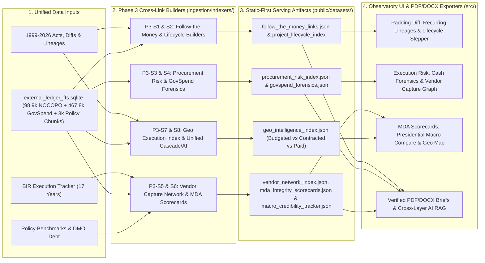

# BudgetLens Phase 3 — Cross-Dataset Forensic Intelligence & Follow-the-Money Roadmap

> **Document Status:** `COMPLETED — ALL STAGES (P3-S1 TO P3-S8) VERIFIED (2026-11-22)`  
> **Created:** `2026-11-21`  
> **Predecessors:** [IMPLEMENTATION_ROADMAP.md](file:///c:/Users/lol/Downloads/Projetcs/buget_lens/IMPLEMENTATION_ROADMAP.md) (Phase 1) | [PHASE2_IMPLEMENTATION_ROADMAP.md](file:///c:/Users/lol/Downloads/Projetcs/buget_lens/PHASE2_IMPLEMENTATION_ROADMAP.md) (Phase 2) | [EXTERNAL_DATA_INGESTION_PLAN.md](file:///c:/Users/lol/Downloads/Projetcs/buget_lens/EXTERNAL_DATA_INGESTION_PLAN.md) (External Data Stages 0–4)  
> **Scope:** Cross-link the original 1999–2026 Federal Budget core (Acts, Bills, Diffs, Recurring Lineages, Geo Intelligence, Statistical Forensics, and DMO Debt) with all four ingested external datasets (`bir_pdfs`, `NocopoJson`, `govspend_data`, and `policy_pdfs`) into precomputed, static-first forensic modules, composite MDA/macro accountability scorecards, vendor-capture network & geo views, and publication-grade PDF/DOCX investigative dossiers.

---

## 1. Mandatory Governance & Engineering Rules

> [!IMPORTANT]
> Every stage in Phase 3 (`P3-S1` through `P3-S8`) MUST strictly follow all six engineering governance rules below without exception:

1. **Sequential Stage Approval Gate (Hard Stop Between Stages):**
   - Execute Stages **`P3-S1` through `P3-S8`** strictly **one stage at a time** in order (`P3-S1` -> `P3-S2` -> ... -> `P3-S8`).
   - After finishing and verifying each stage, present the full verification output (Python pytest results, `tsc -b`, `npx vitest run`, `npm run build`, dataset counts, and UI guard checks) and **wait for explicit user approval** before modifying any files for the next stage (unless the user explicitly approves batching in writing).
2. **Static-First Serving Architecture (`public/datasets/`):**
   - Every Phase 3 dataset under `public/datasets/` MUST be precomputed JSON so all new Observatory views, drill-downs, scorecards, and exports work cleanly with **zero dependency on running `uvicorn`**.
   - Any large detail dataset (`> 2.5 MB` uncompressed) MUST be sharded deterministically (e.g., 64-bucket 32-bit FNV-1a shards `00.json`–`63.json`, keeping every shard `< 2.5 MB`, matching [contractors_leaderboard.py](file:///c:/Users/lol/Downloads/Projetcs/buget_lens/ingestion/parsers/contractors_leaderboard.py) and `public/datasets/contractor_history/`).
   - FastAPI (`backend/`) + `backend/data/external_ledger_fts.sqlite` remains an optional accelerator for full-ledger FTS5 search, backend AI RAG, and citizen field-tip persistence.
3. **Zero Developer / CLI Copy in Public UI:**
   - Never surface `uvicorn`, `FastAPI`, `python -m`, terminal commands, or local ingestion instructions anywhere inside `src/**/*.tsx`. User-facing status copy must be plain-language editorial prose.
4. **Strict Download Format Policy — PDF & DOCX Only:**
   - Every new export action in Phase 3 MUST route exclusively through `triggerVerifiedDocumentDownload()` in [src/utils/documentExporter.ts](file:///c:/Users/lol/Downloads/Projetcs/buget_lens/src/utils/documentExporter.ts) (using `sanitizePdfText()` so `jsPDF` WinAnsi renders `NGN ` cleanly, and OOXML `.docx` with UTF-8 `₦`).
   - Adding `.csv`, `.json`, `.html`, `.md`, or `.svg` download code paths anywhere in `src/` is strictly forbidden (enforced continuously by [tests/unit/documentExporter.test.ts](file:///c:/Users/lol/Downloads/Projetcs/buget_lens/tests/unit/documentExporter.test.ts)).
5. **Global UI & Grounded AI Standards:**
   - Apply [ExpandableText.tsx](file:///c:/Users/lol/Downloads/Projetcs/buget_lens/src/components/ExpandableText.tsx) (`Read more` / `Show less`) consistently across all new tables, cards, and dossier descriptions with long text blocks.
   - AI Assistant responses and suggested follow-up questions ([GroundedAiAssistantWidget.tsx](file:///c:/Users/lol/Downloads/Projetcs/buget_lens/src/components/GroundedAiAssistantWidget.tsx), [backend/routers/ai.py](file:///c:/Users/lol/Downloads/Projetcs/buget_lens/backend/routers/ai.py), [src/utils/aiForensicEngine.ts](file:///c:/Users/lol/Downloads/Projetcs/buget_lens/src/utils/aiForensicEngine.ts)) MUST **never mention raw PDF or document filenames**, and AI Chat MUST **never introduce hardcoded preset project folders**.
6. **Zero-Fabrication, Atomic Writes & Checkpoint Safety:**
   - Never fabricate missing contract awards, disbursement rates, CAC RC numbers, beneficial owners, or geographic allocations where source records omit them. Missing coverage must be reported transparently as an explicit coverage metric or `UNSPECIFIED` / `OCR_PENDING` bucket.
   - Write all JSON and SQLite outputs atomically via temp-file + `os.replace()`.
   - Never modify, stop, or wipe `ingestion/checkpoints_data/`; always preserve `preserve_existing_gemma=True` when updating budget shards or [source_provenance.json](file:///c:/Users/lol/Downloads/Projetcs/buget_lens/public/datasets/source_provenance.json).

---

## 2. Verified Cross-Dataset Baseline & Existing Signals (2026-11-21)

### 2.1 Connected Data Layers Currently on Disk

| Data Layer | Primary Stores on Disk | Verified Volume & Coverage |
|---|---|---|
| **1. Federal Acts, Bills, Diffs & Lineages (1999–2026)** | [registry.json](file:///c:/Users/lol/Downloads/Projetcs/buget_lens/public/datasets/registry.json), [bill_act_diffs/index.json](file:///c:/Users/lol/Downloads/Projetcs/buget_lens/public/datasets/bill_act_diffs/index.json), [recurring_lineages.json](file:///c:/Users/lol/Downloads/Projetcs/buget_lens/public/datasets/recurring_lineages.json), [statistical_forensics_1999_2026.json](file:///c:/Users/lol/Downloads/Projetcs/buget_lens/public/datasets/statistical_forensics_1999_2026.json), [geo_intelligence_index.json](file:///c:/Users/lol/Downloads/Projetcs/buget_lens/public/datasets/geo_intelligence_index.json) | `28` budget years (`1999–2026`), `7` Bill-vs-Act cycles (`2017`, `2019–2023`, `2025`), `3,500` multi-year recurring lineages |
| **2. DMO Public Debt Profile** | [debt_profile.json](file:///c:/Users/lol/Downloads/Projetcs/buget_lens/public/datasets/debt_profile.json) | Annual external & domestic federal debt stock series for administration comparisons |
| **3. Budget Implementation Reports (BIR)** | [execution_tracker.json](file:///c:/Users/lol/Downloads/Projetcs/buget_lens/public/datasets/execution_tracker.json), `bir_ocr_chunks` / `bir_ocr_fts` (`backend/data/external_ledger_fts.sqlite`) | `18` verified years (`2009–2026` consecutive) parsed from all `59` PDFs (`3` full-scanned PDFs / `719` pages OCR'd into `1,247` FTS5 chunks + embedded image-table recovery; `0` skipped) |
| **4. NOCOPO Procurement (BPP OCDS 1.1)** | `nocopo_contracts` / `nocopo_fts` (`backend/data/external_ledger_fts.sqlite`), [procurement_links.json](file:///c:/Users/lol/Downloads/Projetcs/buget_lens/public/datasets/procurement_links.json), [contractors_leaderboard.json](file:///c:/Users/lol/Downloads/Projetcs/buget_lens/public/datasets/contractors_leaderboard.json), `public/datasets/contractor_history/*.json` (`64` shards, `28.89 MB`) | `98,866` deduplicated OCIDs (`15,492` awarded contracts, `₦4.08T` contracted across `9,656` distinct contractors / `2,856` repeat contractors, `9,775` ERGP-linked records) |
| **5. Open Treasury Payments (GovSpend)** | `govspend_payments` / `govspend_fts` (`backend/data/external_ledger_fts.sqlite`), [govspend_summary.json](file:///c:/Users/lol/Downloads/Projetcs/buget_lens/public/datasets/govspend_summary.json) | `467,763` valid payment vouchers (`2018-09-01` to `2026-06-19`), `₦47.53T` disbursed, `952` distinct payer codes, `50,850` normalized beneficiaries, `15,807` split-payment clusters |
| **6. Budget Office Policy & MTEF Documents** | [policy_benchmarks.json](file:///c:/Users/lol/Downloads/Projetcs/buget_lens/public/datasets/policy_benchmarks.json), `policy_chunks` / `policy_fts` (`backend/data/external_ledger_fts.sqlite`) | All `36` valid PDFs indexed (`32` native text + `4` OCR-indexed, `3,214` FTS5 chunks, `14` MTEF macro benchmarks, `0` `OCR_PENDING`) |

### 2.2 Verified Cross-Join Signals Already Sitting in the Database

| Cross-Dataset Join / Signal | Verified Quantitative Finding (from `external_ledger_fts.sqlite` & `public/datasets/`) | Opportunity in Phase 3 |
|---|---|---|
| **Bill vs. Act Diff × NOCOPO** | `372` of `5,886` tracked Bill-vs-Act project codes already match `nocopo_contracts` | Track padded/inserted projects all the way to contract awards & Treasury cash (`P3-S1`) |
| **Recurring Lineages × NOCOPO** | `259` of `3,500` recurring project lineages match `nocopo_contracts` directly by project code | Distinguish legitimate phased builds from "zombie" contractor-switching repeats (`P3-S1`) |
| **NOCOPO Non-Competitive Awards** | Over `₦1.31T` in non-open awards across awarded stages (`Selective Tendering`: `3,663` / `₦732.42B`; `Emergency`: `380` / `₦344.74B`; `Direct Procurement`: `1,007` / `₦216.67B`; `Repeat Procurement`: `246` / `₦16.12B`) | Surface procurement method risk & MDA sole-sourcing profiles (`P3-S3`) |
| **NOCOPO Award vs. Payment Gaps** | `440` awarded contracts where `total_paid_naira > contract_award_naira` (combined overrun delta `₦939.85B`); `3,560` awarded contracts (`₦2,943.71B`) showing `₦0` recorded disbursement | Flag unexplained contract overruns and stalled/unpaid awards (`P3-S3`) |
| **GovSpend Seasonality & Splits** | Across `2019–2025`, December alone has `88,902` vouchers / `₦8.76T` (~2.3x–3x typical `₦2.9T–₦3.8T` month; January drops to `₦1.20T`), plus `15,807` split-payment clusters | Expose December burn-rate spikes, near-threshold splitting, and cash-level Benford anomalies (`P3-S4`) |
| **NOCOPO × GovSpend Discrepancy & Vendor Capture** | `3,798` matched contractors (`2,976` paid `>125%` of NOCOPO award total: `₦4.32T` Treasury vs. `₦1.24T` awards); `75` contractors win across `>= 5` MDAs; `7` captive MDA-vendor pairs (`>= 40%` MDA share, `>= 3` awards); `2,169` GovSpend beneficiaries `>= ₦1B` (`₦38.74T` combined) with zero NOCOPO match | Separate statutory/bank transfers from private companies paid without NOCOPO tenders; map MDA capture networks (`P3-S5`) |
| **Macro & Execution Accountability** | `17` years of BIR fiscal/MDA execution vs. `14` MTEF macro assumptions (`policy_benchmarks.json`) vs. DMO debt stock | Composite MDA Integrity Scorecards & "Promise vs. Reality" presidential/macro credibility tracker (`P3-S6`) |
| **Regional Execution Coverage** | Geo tags exist for annual appropriations (`geo_intelligence_index.json`) while NOCOPO/GovSpend lack state/zone aggregation | Compare Appropriated vs. Contracted vs. Paid across 36 states + FCT with explicit coverage disclosure (`P3-S7`) |
| **OCR Recovery (`ocr_engine.py`)** | `COMPLETED`: `0` `OCR_PENDING` PDFs remaining across `bir_pdfs/` (`3` scanned PDFs / `1,247` `bir_ocr_fts` chunks + embedded image tables unlocking `FY 2014`), `policy_pdfs/` (`4` PDFs / `3,214` total `policy_fts` chunks incl. 2020 & 2023 Finance Acts), and `dmo_pdfs/` (`8` single-page scanned PDFs) | Already available across `execution_tracker.json`, `policy_benchmarks.json`, `debt_profile.json`, and `external_ledger_fts.sqlite` |

---

## 3. Phase 3 Target Architecture



---

## 4. Phased & Staged Execution Plan (4 Phases, 8 Sequential Stages)

### Phase A — End-to-End "Follow the Money" Cross-Links

#### Stage `P3-S1`: "Padded-to-Paid" & "Zombie Projects" Cross-Link Pipeline
- **Objective:** Connect legislative budget alterations ([bill_act_diffs](file:///c:/Users/lol/Downloads/Projetcs/buget_lens/public/datasets/bill_act_diffs/index.json)) and multi-year recurring appropriations ([recurring_lineages.json](file:///c:/Users/lol/Downloads/Projetcs/buget_lens/public/datasets/recurring_lineages.json)) directly to downstream `nocopo_contracts` and `govspend_payments`, identifying which inserted/inflated allocations received contracts and distinguishing legitimate phased multi-year builds from suspicious repeat-funded items.
- **Exact Target Files:**
  - **Ingestion `[New]`:** `ingestion/indexers/follow_the_money_builder.py`
  - **Dataset `[New]`:** `public/datasets/follow_the_money_links.json` (plus 64 FNV-1a shards if linked detail list exceeds `2.5 MB`)
  - **UI `[Update]`:** [src/components/BudgetPaddingDiffExplorer.tsx](file:///c:/Users/lol/Downloads/Projetcs/buget_lens/src/components/BudgetPaddingDiffExplorer.tsx), [src/components/RecurringLineagesExplorer.tsx](file:///c:/Users/lol/Downloads/Projetcs/buget_lens/src/components/RecurringLineagesExplorer.tsx)
  - **Tests `[New/Update]`:** `tests/python/test_follow_the_money.py`, Vitest unit tests
- **Key Technical & Anti-Pitfall Rules:**
  - Match primarily by exact normalized `ERGP` project code (`EXACT_ERGP_CODE`), with secondary matching on canonical MDA (`entity_normalizer.py`) + high-token-overlap project title explicitly labeled `FUZZY_MDA_TITLE` and scored with confidence (`>= 0.78`) — never merge weak guesses silently.
  - Classify each linked recurring lineage deterministically into `ACTIVE_PHASED_BUILD` (consistent multi-year vendor + disbursement progress), `VENDOR_SWITCHED_REPEAT` (multiple distinct contractors winning the same recurring project code across years), `AWARDED_UNPAID` (awarded in NOCOPO with `₦0` recorded payment), or `BUDGET_ONLY_REPEAT` (zero public procurement match).
  - Restrict contractor award aggregation to `stage IN ('award', 'contract', 'implementation')` so planning estimates never inflate contracted totals.
  - Clicking any linked contractor opens [ContractorHistoryModal.tsx](file:///c:/Users/lol/Downloads/Projetcs/buget_lens/src/components/ContractorHistoryModal.tsx) using static FNV-1a shards; wrap long project descriptions with `<ExpandableText />`.
- **Verification Gate:**
  - `.venv\Scripts\python.exe -m ingestion.indexers.follow_the_money_builder`
  - `.venv\Scripts\python.exe -m pytest tests/python/test_follow_the_money.py`
  - `npx tsc -b; if ($LASTEXITCODE -eq 0) { npx vitest run }; if ($LASTEXITCODE -eq 0) { npm run build }`

#### Stage `P3-S2`: Unified 5-Stage Project Lifecycle Timeline & "Paid-on-Paper" Citizen Verification
- **Objective:** Upgrade project-level views so every high-value or procurement-linked budget line item renders a unified 5-stage audit chain (`MTEF Macro Context` -> `Bill vs. Act Delta` -> `Parent MDA BIR Release %` -> `NOCOPO Contract & Vendor` -> `GovSpend Treasury Vouchers`) and highlights **"Paid on Paper — Field Verification Priority"** items inside Citizen Evidence.
- **Exact Target Files:**
  - **Ingestion `[New]`:** `ingestion/indexers/project_lifecycle_builder.py`
  - **Dataset `[New]`:** `public/datasets/project_lifecycle_index.json` (or 64-bucket FNV-1a shards `public/datasets/project_lifecycle/00.json`–`63.json` keyed by `project_code` / `budgetRecordId` so each shard stays `< 2.5 MB`)
  - **UI `[New/Update]`:** `src/components/ProjectLifecycleStepper.tsx` `[New]`, [src/components/BudgetRecordDossierPage.tsx](file:///c:/Users/lol/Downloads/Projetcs/buget_lens/src/components/BudgetRecordDossierPage.tsx), [src/components/ProjectEvidenceModal.tsx](file:///c:/Users/lol/Downloads/Projetcs/buget_lens/src/components/ProjectEvidenceModal.tsx), [src/components/PublicScrutinyDossier.tsx](file:///c:/Users/lol/Downloads/Projetcs/buget_lens/src/components/PublicScrutinyDossier.tsx)
  - **Tests `[New/Update]`:** `tests/python/test_project_lifecycle.py`, Vitest unit tests
- **Key Technical & Anti-Pitfall Rules:**
  - Match MTEF macro context by `financialYear` from [policy_benchmarks.json](file:///c:/Users/lol/Downloads/Projetcs/buget_lens/public/datasets/policy_benchmarks.json), BIR MDA utilization by `entity_normalizer.py` canonical MDA name (marking missing years as `NO_MDA_BREAKDOWN` instead of `0%`), and procurement/payments from SQLite cross-links.
  - Surface a prominent `"Paid on Paper — Field Verification Priority"` badge in [ProjectEvidenceModal.tsx](file:///c:/Users/lol/Downloads/Projetcs/buget_lens/src/components/ProjectEvidenceModal.tsx) only when verified NOCOPO disbursement (`totalPaidNaira > 0`) or verified GovSpend cross-linked payouts exist for that record/vendor.
  - Zero developer/CLI strings if FastAPI tips endpoint is offline; gracefully degrade citizen-tip submission feedback to plain user messaging.
- **Verification Gate:**
  - `.venv\Scripts\python.exe -m ingestion.indexers.project_lifecycle_builder`
  - `.venv\Scripts\python.exe -m pytest tests/python/test_project_lifecycle.py`
  - `npx tsc -b; if ($LASTEXITCODE -eq 0) { npx vitest run }; if ($LASTEXITCODE -eq 0) { npm run build }`

---

### Phase B — Procurement Risk, Treasury Forensics & Vendor Capture

#### Stage `P3-S3`: Non-Competitive Procurement Risk & Variation Overrun Monitor
- **Objective:** Expose systemic procurement risks across all `15,492` awarded NOCOPO contracts (`₦4.08T`), quantifying non-competitive tender methods (`Selective Tendering`, `Emergency`, `Direct Procurement`, `Repeat Procurement`), contract payment overruns (`440` contracts / `₦939.85B` over award), and stalled zero-payment awards (`3,560` contracts / `₦2.94T`).
- **Exact Target Files:**
  - **Ingestion `[New]`:** `ingestion/indexers/procurement_risk_builder.py`
  - **Dataset `[New]`:** `public/datasets/procurement_risk_index.json`
  - **Exporter & UI `[Update]`:** [src/components/ExecutionProcurementExplorer.tsx](file:///c:/Users/lol/Downloads/Projetcs/buget_lens/src/components/ExecutionProcurementExplorer.tsx), [src/utils/documentExporter.ts](file:///c:/Users/lol/Downloads/Projetcs/buget_lens/src/utils/documentExporter.ts)
  - **Tests `[New/Update]`:** `tests/python/test_procurement_risk.py`, [tests/unit/documentExporter.test.ts](file:///c:/Users/lol/Downloads/Projetcs/buget_lens/tests/unit/documentExporter.test.ts)
- **Key Technical & Anti-Pitfall Rules:**
  - Strictly filter method and overrun calculations to `stage IN ('award', 'contract', 'implementation')` — never mix `planning`-only records (`81,233` items with estimated budget values) into awarded totals or overrun ratios.
  - Compute per-MDA non-competitive value share, overrun count/value, zero-disbursement count/value, and contract-level flags (capped to top verifiable outlier lists in summary JSON so payload stays `< 2 MB`).
  - Route Procurement Risk PDF and DOCX exports strictly through `triggerVerifiedDocumentDownload()` + `sanitizePdfText()`, keeping zero forbidden file extensions in `src/`.
- **Verification Gate:**
  - `.venv\Scripts\python.exe -m ingestion.indexers.procurement_risk_builder`
  - `.venv\Scripts\python.exe -m pytest tests/python/test_procurement_risk.py`
  - `npx tsc -b; if ($LASTEXITCODE -eq 0) { npx vitest run }; if ($LASTEXITCODE -eq 0) { npm run build }`

#### Stage `P3-S4`: December Spending Rush, Threshold-Splitting & GovSpend Benford Forensics
- **Objective:** Bring actual Treasury cash disbursements (`467,763` GovSpend vouchers totaling `₦47.53T`) into [StatisticalForensicsLab.tsx](file:///c:/Users/lol/Downloads/Projetcs/buget_lens/src/components/StatisticalForensicsLab.tsx), surfacing year-end December spending surges (`₦8.76T` across `88,902` vouchers in Dec 2019–2025), near-threshold voucher clustering just below statutory approval limits, and first-digit/first-two-digit Benford MAD analysis on actual cash payments.
- **Exact Target Files:**
  - **Ingestion `[New/Update]`:** `ingestion/indexers/govspend_forensics_builder.py` `[New]` (or shared helpers from [ingestion/parsers/govspend_indexer.py](file:///c:/Users/lol/Downloads/Projetcs/buget_lens/ingestion/parsers/govspend_indexer.py) & [ingestion/indexers/statistical_forensics_builder.py](file:///c:/Users/lol/Downloads/Projetcs/buget_lens/ingestion/indexers/statistical_forensics_builder.py))
  - **Dataset `[New]`:** `public/datasets/govspend_forensics.json`
  - **Exporter & UI `[Update]`:** [src/components/StatisticalForensicsLab.tsx](file:///c:/Users/lol/Downloads/Projetcs/buget_lens/src/components/StatisticalForensicsLab.tsx), [src/utils/documentExporter.ts](file:///c:/Users/lol/Downloads/Projetcs/buget_lens/src/utils/documentExporter.ts)
  - **Tests `[New/Update]`:** `tests/python/test_govspend_forensics.py`, [tests/unit/statisticalForensics.test.ts](file:///c:/Users/lol/Downloads/Projetcs/buget_lens/tests/unit/statisticalForensics.test.ts)
- **Key Technical & Anti-Pitfall Rules:**
  - Compute **December Rush Ratio** (`December average daily/monthly cash spend / Jan–Nov baseline average`) per year and per MDA, excluding incomplete boundary years cleanly (e.g., partial `2018` starting Sept and partial `2026` ending June flagged as partial-year controls).
  - Measure near-threshold clustering in configurable `[0.90T, T)` bands immediately beneath `₦5M`, `₦10M`, `₦50M`, and `₦100M` approval ceilings alongside rolling 7-day MDA–beneficiary split-payment clusters (`15,807` existing clusters).
  - Run Benford first-digit (`1–9`) and first-two-digit (`10–99`) MAD on strictly positive (`>= ₦1,000`) cash vouchers overall and for top-volume MDAs (min sample size `N >= 500` to avoid noisy small-sample false alarms).
- **Verification Gate:**
  - `.venv\Scripts\python.exe -m ingestion.indexers.govspend_forensics_builder`
  - `.venv\Scripts\python.exe -m pytest tests/python/test_govspend_forensics.py tests/python/test_statistical_forensics.py`
  - `npx tsc -b; if ($LASTEXITCODE -eq 0) { npx vitest run }; if ($LASTEXITCODE -eq 0) { npm run build }`

#### Stage `P3-S5`: MDA ↔ Contractor Capture Network & "Off-NOCOPO" Private Vendors Audit
- **Objective:** Reveal vendor-concentration relationships across federal MDAs (HHI concentration, `7` captive `>= 40%` MDA–vendor pairs, `75` multi-MDA contractors spanning `>= 5` ministries) and cleanly separate statutory/bank/internal Treasury transfers from **private corporate entities** (`LTD`, `PLC`, `VENTURES`, `ENTERPRISES`, etc.) receiving high GovSpend payouts without matching public NOCOPO awards.
- **Exact Target Files:**
  - **Ingestion `[New]`:** `ingestion/indexers/vendor_network_builder.py` (reusing [ingestion/parsers/entity_normalizer.py](file:///c:/Users/lol/Downloads/Projetcs/buget_lens/ingestion/parsers/entity_normalizer.py))
  - **Dataset `[New]`:** `public/datasets/vendor_network_index.json`
  - **UI `[New/Update]`:** `src/components/VendorCaptureNetworkView.tsx` `[New]`, wired into [src/components/ExecutionProcurementExplorer.tsx](file:///c:/Users/lol/Downloads/Projetcs/buget_lens/src/components/ExecutionProcurementExplorer.tsx) and [src/components/ContractorHistoryModal.tsx](file:///c:/Users/lol/Downloads/Projetcs/buget_lens/src/components/ContractorHistoryModal.tsx)
  - **Tests `[New/Update]`:** `tests/python/test_vendor_network.py`, Vitest unit tests
- **Key Technical & Anti-Pitfall Rules:**
  - Build a deterministic **Beneficiary Entity Classifier** taxonomy (`PRIVATE_CORPORATE`, `STATUTORY_GOV_MDA`, `BANK_FINANCIAL`, `TAX_REVENUE_PENSION_PAYROLL`, `STAFF_OR_INDIVIDUAL`, `UNCLASSIFIED`) and verify via strict unit tests that CBN, OAGF, FIRS, PenCom, IPPIS, Federal Ministries, commercial banks, and payroll/TSA sweeps are **never** mislabeled as "Unlisted Private Vendors".
  - Compute per-MDA Herfindahl-Hirschman Index (`HHI = sum(share_i^2)`) strictly across awarded stages (`stage IN ('award', 'contract', 'implementation')`), alongside NOCOPO-vs-GovSpend `> 125%` payout discrepancy rankings (`2,976` matched entities).
  - Precompute clean bipartite graph adjacency lists for top captured MDAs and multi-MDA super-contractors so the interactive SVG network renders smoothly without runtime graph layout bottlenecks.
- **Verification Gate:**
  - `.venv\Scripts\python.exe -m ingestion.indexers.vendor_network_builder`
  - `.venv\Scripts\python.exe -m pytest tests/python/test_vendor_network.py`
  - `npx tsc -b; if ($LASTEXITCODE -eq 0) { npx vitest run }; if ($LASTEXITCODE -eq 0) { npm run build }`

---

### Phase C — Composite Accountability Scorecards, Macro Reality & Geo Execution

#### Stage `P3-S6`: Composite MDA Integrity Scorecard & "Promise vs. Reality" Macro Credibility
- **Objective:** Synthesize all layers per federal ministry into an explainable **MDA Integrity Scorecard** inside **Ministries & MDAs**, and upgrade Presidential & Macro scrutiny views ([HistoricalPresidentialCompare.tsx](file:///c:/Users/lol/Downloads/Projetcs/buget_lens/src/components/HistoricalPresidentialCompare.tsx) & [PublicScrutinyDossier.tsx](file:///c:/Users/lol/Downloads/Projetcs/buget_lens/src/components/PublicScrutinyDossier.tsx)) with MTEF assumption accuracy, BIR capital release/utilization vs. debt-service overrun trends across administrations.
- **Exact Target Files:**
  - **Ingestion `[New]`:** `ingestion/indexers/mda_scorecard_builder.py`
  - **Datasets `[New]`:** `public/datasets/mda_integrity_scorecards.json`, `public/datasets/macro_credibility_tracker.json`
  - **UI `[Update]`:** [src/components/TopMinistriesWidget.tsx](file:///c:/Users/lol/Downloads/Projetcs/buget_lens/src/components/TopMinistriesWidget.tsx) (or MDA directory container where `agencies` renders), [src/components/HistoricalPresidentialCompare.tsx](file:///c:/Users/lol/Downloads/Projetcs/buget_lens/src/components/HistoricalPresidentialCompare.tsx), [src/components/PublicScrutinyDossier.tsx](file:///c:/Users/lol/Downloads/Projetcs/buget_lens/src/components/PublicScrutinyDossier.tsx)
  - **Tests `[New/Update]`:** `tests/python/test_mda_scorecard.py`, Vitest unit tests
- **Key Technical & Anti-Pitfall Rules:**
  - Canonicalize MDA names across Bills/Acts, BIR tables, NOCOPO `buyer_admin_code`/`norm_mda`, and GovSpend `payer_code`/`norm_mda` via `entity_normalizer.py`.
  - Use a transparent, open-formula rubric (e.g., `Padding Restraint`, `BIR Capital Execution`, `Open Bidding Share`, `Vendor Diversification (1 - HHI)`, `Cash Discipline (Low Splits & Dec Surge)`) where **unavailable dimensions for a given MDA are omitted from its active weight denominator** (`metricsPresent / totalExpectedMetrics` reported explicitly) — never assign `0` points for missing source coverage.
  - Pair every composite score badge with an inspectable pillar-by-pillar breakdown drawer so citizens and journalists see raw underlying counts and percentages, not an opaque score.
- **Verification Gate:**
  - `.venv\Scripts\python.exe -m ingestion.indexers.mda_scorecard_builder`
  - `.venv\Scripts\python.exe -m pytest tests/python/test_mda_scorecard.py`
  - `npx tsc -b; if ($LASTEXITCODE -eq 0) { npx vitest run }; if ($LASTEXITCODE -eq 0) { npm run build }`

#### Stage `P3-S7`: 36-State + FCT "Budgeted vs. Contracted vs. Paid" Map & One-Click Forensic Dossier Exports
- **Objective:** Extend state and geopolitical-zone mapping in [GeoMapWidget.tsx](file:///c:/Users/lol/Downloads/Projetcs/buget_lens/src/components/GeoMapWidget.tsx) with **Contracted (`NOCOPO`)** and **Disbursed (`GovSpend`)** layers alongside existing **Appropriated Capital**, and add one-click **Forensic Investigation Brief (PDF / DOCX)** exports on Contractors, MDA Scorecards, and Budget Records.
- **Exact Target Files:**
  - **Ingestion `[Update]`:** [ingestion/indexers/geo_asset_indexer.py](file:///c:/Users/lol/Downloads/Projetcs/buget_lens/ingestion/indexers/geo_asset_indexer.py) (using [ingestion/enrichers/geo_taxonomy.py](file:///c:/Users/lol/Downloads/Projetcs/buget_lens/ingestion/enrichers/geo_taxonomy.py))
  - **Dataset `[Update]`:** [public/datasets/geo_intelligence_index.json](file:///c:/Users/lol/Downloads/Projetcs/buget_lens/public/datasets/geo_intelligence_index.json)
  - **Exporter & UI `[Update]`:** [src/utils/documentExporter.ts](file:///c:/Users/lol/Downloads/Projetcs/buget_lens/src/utils/documentExporter.ts), [src/components/GeoMapWidget.tsx](file:///c:/Users/lol/Downloads/Projetcs/buget_lens/src/components/GeoMapWidget.tsx), [src/components/ContractorHistoryModal.tsx](file:///c:/Users/lol/Downloads/Projetcs/buget_lens/src/components/ContractorHistoryModal.tsx), [src/components/BudgetRecordDossierPage.tsx](file:///c:/Users/lol/Downloads/Projetcs/buget_lens/src/components/BudgetRecordDossierPage.tsx)
  - **Tests `[New/Update]`:** `tests/python/test_geo_execution.py`, [tests/unit/documentExporter.test.ts](file:///c:/Users/lol/Downloads/Projetcs/buget_lens/tests/unit/documentExporter.test.ts)
- **Key Technical & Anti-Pitfall Rules:**
  - Geo-tag NOCOPO awards via linked `ERGP` project state + contract title location tokens, and geo-tag GovSpend vouchers via description location tokens; **explicitly isolate `Nationwide / Abuja HQ / Unspecified State` spend** and surface `geoMatchedPct` in the Map banner so central headquarters disbursements are never falsely attributed to FCT state-level infrastructure.
  - Compile multi-layer PDF/DOCX Forensic Briefs strictly via `triggerVerifiedDocumentDownload()` + `sanitizePdfText()`, tested for `%PDF-` and `PK` OOXML binary headers in Vitest.
- **Verification Gate:**
  - `.venv\Scripts\python.exe -m ingestion.indexers.geo_asset_indexer`
  - `.venv\Scripts\python.exe -m pytest tests/python/test_geo_execution.py`
  - `npx tsc -b; if ($LASTEXITCODE -eq 0) { npx vitest run }; if ($LASTEXITCODE -eq 0) { npm run build }`

---

### Phase D — Unified Cascade & AI Integration *(Local OCR Pre-Completed)*

#### Stage `P3-S8`: Unified Phase 3 Pipeline Cascade & Cross-Dataset AI Grounding
- **Objective:** Wire all Phase 3 builders into [ingestion/indexers/cascade.py](file:///c:/Users/lol/Downloads/Projetcs/buget_lens/ingestion/indexers/cascade.py), refresh SHA-256 provenance if needed, and teach the Grounded AI Assistant to query Phase 3 scorecards, procurement risks, `bir_ocr_fts`, and follow-the-money links natively while continuing to hide document filenames. *(Note: Local zero-skip OCR recovery across all BIR, Policy, and DMO scanned PDFs was already completed upfront via [ocr_engine.py](file:///c:/Users/lol/Downloads/Projetcs/buget_lens/ingestion/parsers/ocr_engine.py).)*
- **Exact Target Files:**
  - **Ingestion `[Update]`:** [ingestion/indexers/cascade.py](file:///c:/Users/lol/Downloads/Projetcs/buget_lens/ingestion/indexers/cascade.py), [ingestion/indexers/build_provenance_manifest.py](file:///c:/Users/lol/Downloads/Projetcs/buget_lens/ingestion/indexers/build_provenance_manifest.py)
  - **Backend & AI `[Update]`:** [backend/routers/ai.py](file:///c:/Users/lol/Downloads/Projetcs/buget_lens/backend/routers/ai.py), [src/utils/aiForensicEngine.ts](file:///c:/Users/lol/Downloads/Projetcs/buget_lens/src/utils/aiForensicEngine.ts), [src/components/GroundedAiAssistantWidget.tsx](file:///c:/Users/lol/Downloads/Projetcs/buget_lens/src/components/GroundedAiAssistantWidget.tsx)
  - **Datasets `[Refresh]`:** `public/datasets/source_provenance.json`, `backend/data/external_ledger_fts.sqlite`
  - **Tests `[Update]`:** [tests/python/test_search_ai.py](file:///c:/Users/lol/Downloads/Projetcs/buget_lens/tests/python/test_search_ai.py), [tests/unit/aiForensicEngine.test.ts](file:///c:/Users/lol/Downloads/Projetcs/buget_lens/tests/unit/aiForensicEngine.test.ts)
- **Key Technical & Anti-Pitfall Rules:**
  - Add `--phase3` target to `cascade.py` (preserving existing Stage-2 `ingestion/checkpoints_data/` and `preserve_existing_gemma=True`, while keeping OCR caches under `ingestion/ocr_cache/` warm).
  - Strictly preserve existing AI rules: sanitize/strip any `.pdf` / `.json` / `.csv` filenames from AI answers and generated follow-up prompts, and keep `GroundedAiAssistantWidget.tsx` free of preset project folders.
- **Verification Gate:**
  - Full Python regression suite across Phase 1–3 tests
  - Recursive UI hygiene check confirming zero `uvicorn|FastAPI|python -m` strings in `src/**/*.tsx`
  - `npx tsc -b; if ($LASTEXITCODE -eq 0) { npx vitest run }; if ($LASTEXITCODE -eq 0) { npm run build }`

---

## 5. Master Phase & Stage Tracker

| Stage | Phase | Deliverable Title | Primary Data Outputs (`public/datasets/`) | Dependencies | Works Without Backend | Status | Approval Gate |
|---|---|---|---|---|---|---|---|
| **P3-S1** | Phase A | "Padded-to-Paid" & "Zombie Projects" Cross-Link Pipeline | `follow_the_money_links.json` | Stage 2 & Stage 3 External Ingestion | Yes (100% Static) | `COMPLETED` | Verified (`374.1 KB`, `106` contracted diff items / `₦253.10B`, `3,500` lineages classified incl. `6` vendor-switched & `18` active builds; `pytest` `44 passed`, zero UI CLI strings, `tsc -b`, `vitest` `15 files / 52 passed`, `vite build` exit `0`) |
| **P3-S2** | Phase A | Unified 5-Stage Project Lifecycle Timeline & "Paid-on-Paper" Verify | `project_lifecycle_index.json` + `project_lifecycle/*.json` (`64` shards) | `P3-S1`, Stage 1–4 External | Yes (100% Static) | `COMPLETED` | Verified (`680.3 KB` index, `64` shards `<= 1,435.6 KB`, `40,655` linked records, `3,096` Paid-on-Paper incl. `2,587` direct paid & `508` ERGP Treasury vouchers, `1,269` scrutiny badges; `pytest` `48 passed`, zero UI CLI strings, `tsc -b`, `vitest` `16 files / 57 passed`, `vite build` exit `0`) |
| **P3-S3** | Phase B | Non-Competitive Procurement Risk & Variation Overrun Monitor | `procurement_risk_index.json` | Stage 2 NOCOPO SQLite | Yes (100% Static) | `COMPLETED` | Verified (`240.4 KB`, `16,726` awarded / `₦4.38T`, `82,140` planning/tender excluded, `5,481` non-competitive (`29.93%`), `440` overruns (`+₦939.85B`), `3,560` zero-paid (`₦2.94T`); `pytest` `51 passed`, zero UI CLI strings, `tsc -b`, `vitest` `16 files / 58 passed`, `vite build` exit `0`) |
| **P3-S4** | Phase B | December Spending Rush, Threshold-Splitting & Cash Benford Forensics | `govspend_forensics.json` | Stage 3 GovSpend SQLite | Yes (100% Static) | `COMPLETED` | Verified (`43.5 KB`, `467,763` vouchers / `₦47.53T`, Dec `2019–2025` `₦8.76T` (`2.75x` rush; `2018` & `2026` flagged partial), `34,027` near-threshold vouchers / `₦1,040.48B`, `16,996` 7-day splits, Cash Benford `1D MAD=0.03739` / `2D MAD=0.00387`; `pytest` `54 passed`, zero UI CLI strings, `tsc -b`, `vitest` `16 files / 59 passed`, `vite build` exit `0`) |
| **P3-S5** | Phase B | MDA ↔ Contractor Capture Network & "Off-NOCOPO" Private Vendors Audit | `vendor_network_index.json` | Stage 2 & Stage 3 SQLite | Yes (100% Static) | `COMPLETED` | Verified (`191.0 KB`, `7` captive `>=40%` pairs, `83` multi-MDA `>=5` contractors, `3,377/4,340` `>125%` discrepancy (`₦4.86T` Treasury vs `₦0.76T` NOCOPO), `25,869` private Off-NOCOPO firms (`₦6.74T` / `1,111 >= ₦1B`) cleanly separated from statutory/bank/payroll transfers; `pytest` `58 passed`, zero UI CLI strings, `tsc -b`, `vitest` `17 files / 63 passed`, `vite build` exit `0`) |
| **P3-S6** | Phase C | Composite MDA Integrity Scorecard & "Promise vs. Reality" Macro Credibility | `mda_integrity_scorecards.json`, `macro_credibility_tracker.json` | `P3-S3`, `P3-S4`, `P3-S5`, Stage 1 & 4 | Yes (100% Static) | `COMPLETED` | Verified (`349.7 KB` scorecards (`250/818` MDAs, `21` 5-pillar, `125` 4+-pillar, median `58.7`) & `24.5 KB` macro tracker (`18` BIR yrs `2009–2026`, `11` debt-service overrun yrs, mean cap `53.5%`, mean debt svc `107.6%`, FY15 `111.2%` guarded, Obasanjo marked Pre-2009 N/A); `pytest` `61 passed`, zero UI CLI strings, `tsc -b`, `vitest` `18 files / 67 passed`, `vite build` exit `0`) |
| **P3-S7** | Phase C | 36-State + FCT "Budgeted vs. Contracted vs. Paid" Map & Dossier Briefs | `geo_intelligence_index.json` (updated) | `P3-S1`, Stage 2 & Stage 3 | Yes (100% Static) | `COMPLETED` | Verified (`5,471.2 KB` across 37 states + 6 zones; NOCOPO awarded `9,670/16,726` geo-tagged (`59.8%` / `₦1.76T` HQ isolated / `82,140` planning excluded), GovSpend `247,750/467,763` geo-tagged (`26.7%` / `₦34.82T` HQ isolated), Ogun `"ifo"` false positive fixed (`₦5.09T -> ₦762.5B`), FCT HQ isolated; Contractor/MDA/Record PDF & DOCX Briefs; `pytest` `65 passed`, zero UI CLI strings, `tsc -b`, `vitest` `18 files / 68 passed`, `vite build` exit `0`) |
| **P3-S8** | Phase D | Unified Phase 3 Pipeline Cascade & Cross-Dataset AI Grounding | `source_provenance.json`, FTS5 SQLite | `P3-S1` through `P3-S7` | Static UI + Optional FastAPI AI | `COMPLETED` | Verified (`--phase3` CLI & `run_phase3()` 8-step dependency cascade preserving Stage-2 checkpoints; `source_provenance.json` refreshed across `28` yrs / `468` budget files + `dmo_pdfs` + `9` Phase 3 entries; FastAPI `/api/ai/query` & static `aiForensicEngine.ts` grounded across Phase 3 scorecards/procurement/cash/vendor/FTM + `bir_ocr_fts` with zero leaked `.pdf`/`.json`/`.csv` or internal jargon; `pytest` `67 passed`, zero UI CLI strings, `tsc -b`, `vitest` `19 files / 73 passed`, `vite build` exit `0`) |

---

## 6. Standard Verification Protocol (PowerShell 5.1)

Every stage gate MUST pass all checks below using the workspace virtual environment `.venv\Scripts\python.exe` and Windows PowerShell 5.1-safe command chaining (note: never use `&&` in Windows PowerShell 5.1):

```powershell
# 1. Run Python dataset & API verification tests
.venv\Scripts\python.exe -m pytest tests/python/

# 2. Verify zero developer/CLI strings leak into public React components
$cliHits = Get-ChildItem -Path "src" -Filter "*.tsx" -Recurse | Select-String -Pattern "uvicorn|FastAPI|python -m"
if ($cliHits) { $cliHits; throw "Developer CLI strings found in src/**/*.tsx" } else { "ZERO_UI_DEVELOPER_STRINGS_RECURSIVE" }

# 3. Verify TypeScript compilation, Vitest unit suite (incl. PDF/DOCX export guard), and Vite production bundle
npx tsc -b; if ($LASTEXITCODE -eq 0) { npx vitest run }; if ($LASTEXITCODE -eq 0) { npm run build }
```

---

## 7. Phase 3 Completion Summary

All stages executed sequentially and verified against the PowerShell 5.1 regression gate:

1. **Executed Sequence:** Completed **`P3-S1`** through **`P3-S8`** in dependency order (`Follow the Money` -> `Lifecycle` -> `Procurement Risk` -> `GovSpend Forensics` -> `Vendor Network` -> `MDA Scorecards` -> `Geo Execution & Briefs` -> `Unified Geo & Anomaly Map` upgrade -> `Cascade & Cross-Dataset AI Grounding`).
2. **Threshold-Splitting Ceiling Tiers (`P3-S4`):** Applied the default near-threshold `[90%, 100%)` watch tiers at **`₦5M`**, **`₦10M`**, **`₦50M`**, and **`₦100M`** (`34,027` near-threshold vouchers totaling `₦1,040.48B`; `16,996` rolling 7-day clusters).
3. **Final Verified Gate (`2026-11-22`):** `.venv\Scripts\python.exe -m pytest tests/python/` (`67 passed`), recursive `src/**/*.tsx` CLI check (`ZERO_UI_DEVELOPER_STRINGS_RECURSIVE`), `npx tsc -b` (exit `0`), `npx vitest run` (`19 files / 73 tests passed`), and `npm run build` (exit `0`).
